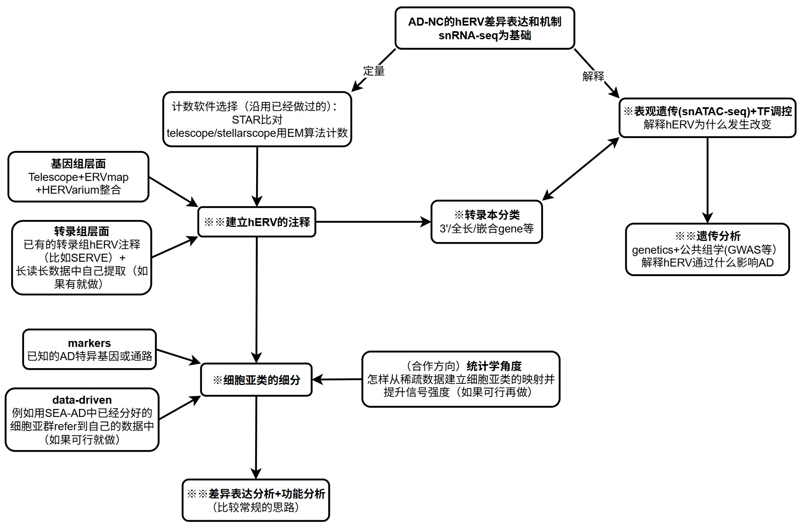
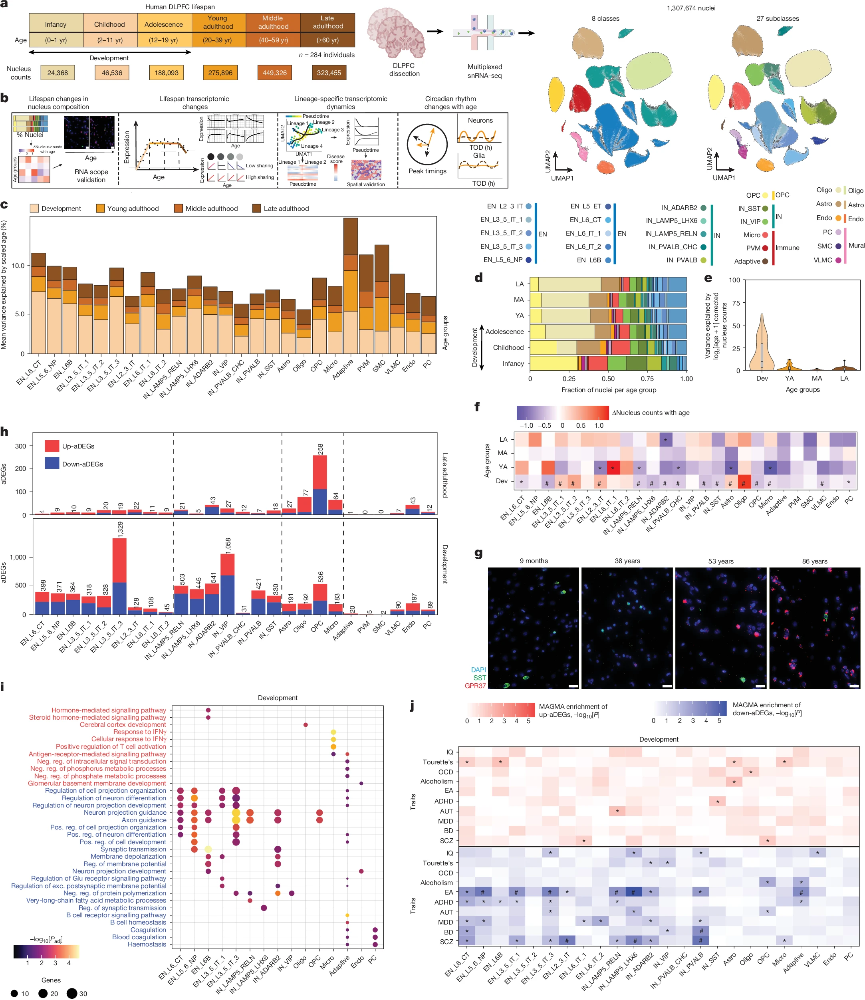
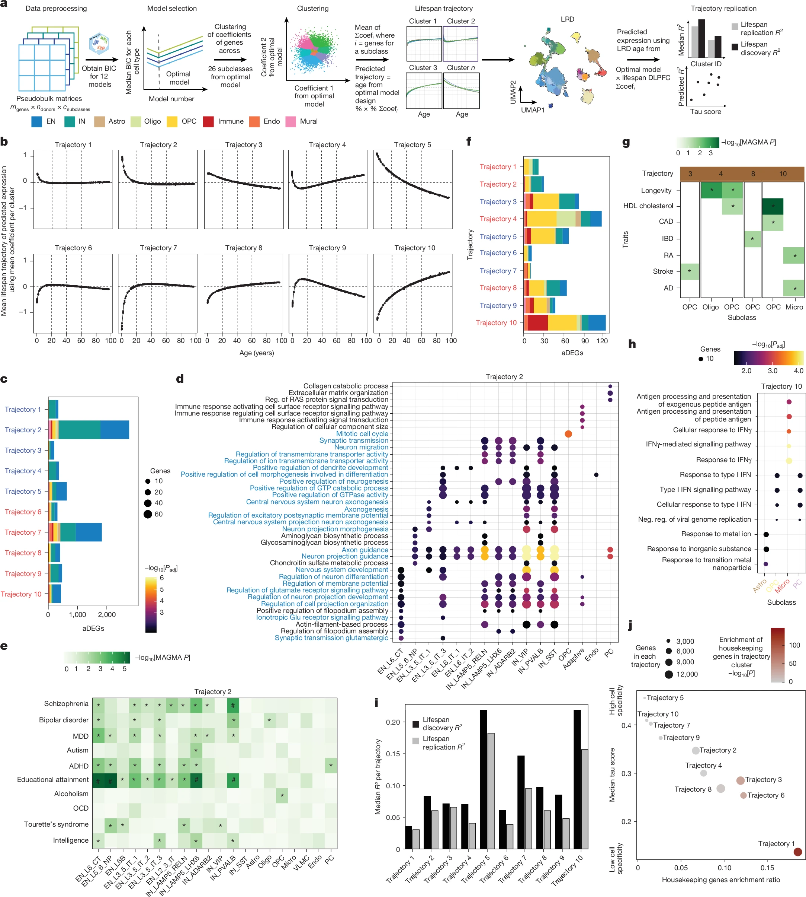
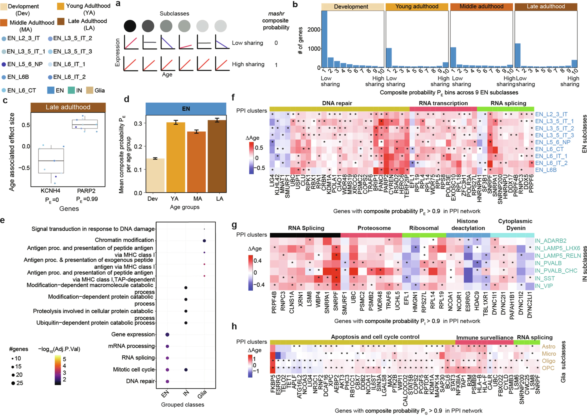
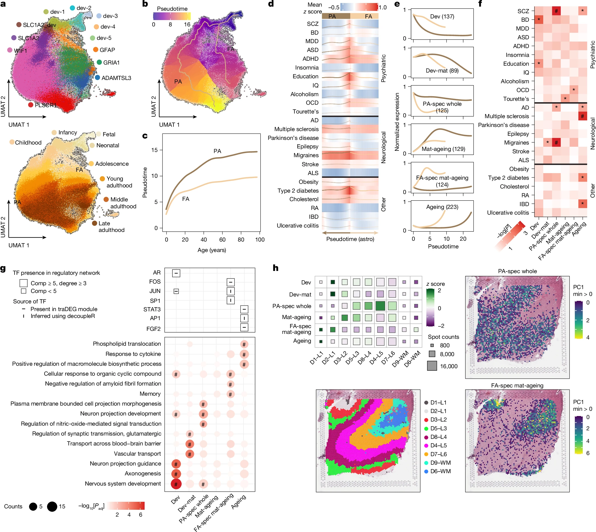
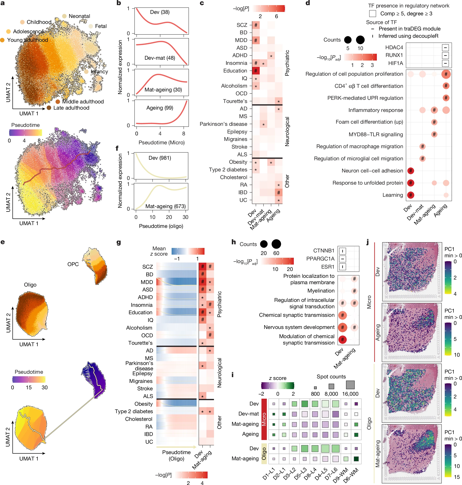
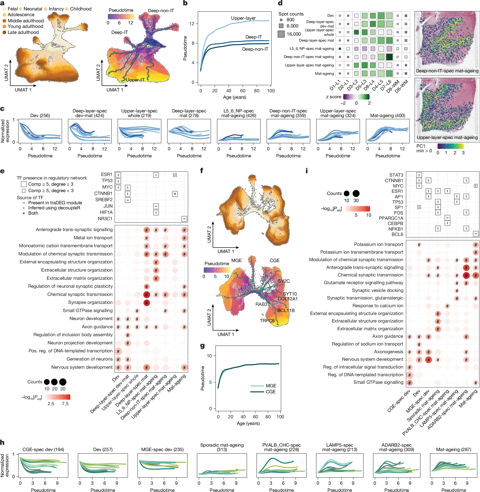
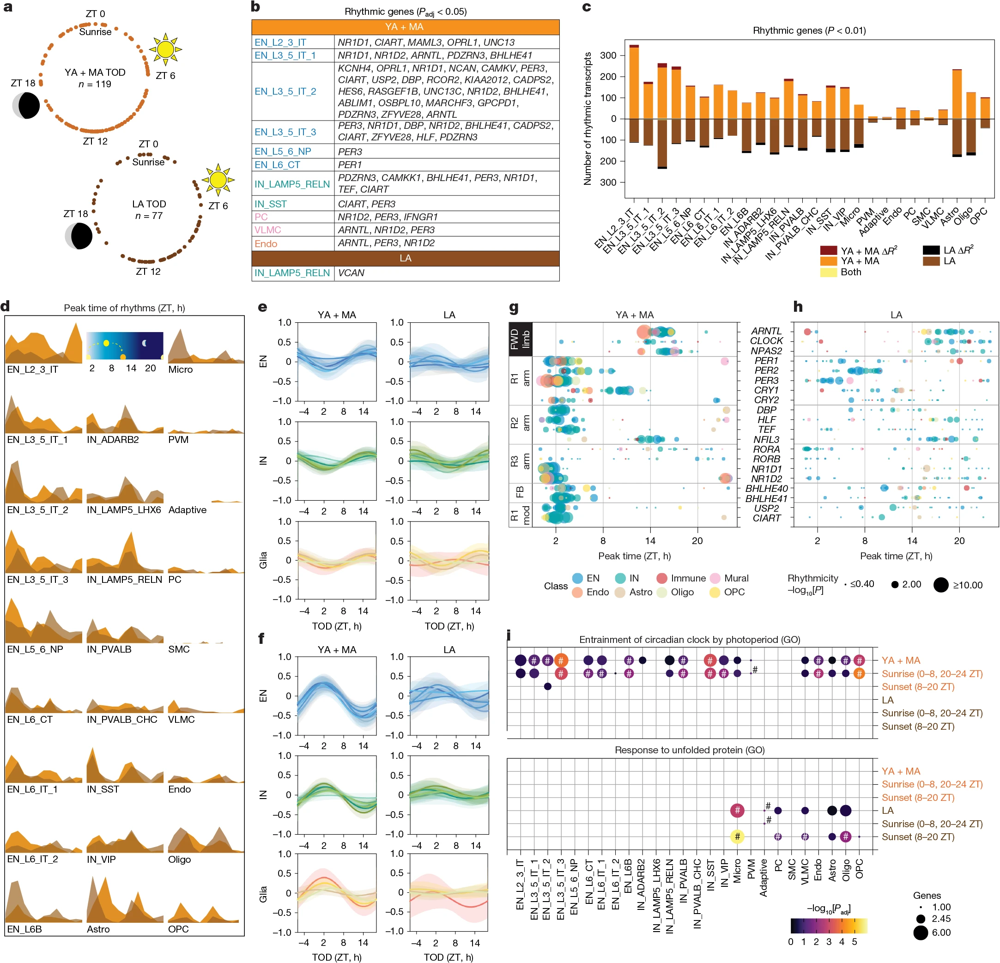

Systematic characterization of disease-relevant transcription, transcript structures and regulatory mechanisms of human endogenous retroviruses in Alzheimer’s cortex

<!-- more -->

| 数据集                                                                                                                    | 样本量                                                   | 脑区                                     | 建库方法/详细信息                                                          | 用途                                                                      |
| ------------------------------------------------------------------------------------------------------------------------- | -------------------------------------------------------- | ---------------------------------------- | -------------------------------------------------------------------------- | ------------------------------------------------------------------------- |
| [GSE157827](https://www.ncbi.nlm.nih.gov/geo/query/acc.cgi?acc=GSE157827)                                                 | snRNA：12AD+9NC                                          | 前额叶皮层PFC                            | 10x 3′v3                                                                   | 差异表达                                                                  |
| [GSE174367](https://www.ncbi.nlm.nih.gov/geo/query/acc.cgi?acc=GSE174367)                                                 | snRNA：11AD+7NC<br>snATAC：12AD+8NC<br>191份bulk RNA     | 主要为前额叶皮层PFC，bulk包含多个脑区    | snRNA：10x 3′v3<br>snATAC：10x ATAC v1<br>bulk：SMARTer Stranded Total RNA | snRNA差异表达<br>snATAC染色质开放+TF调控<br>bulk转录结构验证+差异表达验证 |
| [GSE214979](https://ncbi.nlm.nih.gov/geo/query/acc.cgi?acc=GSE214979)                                                     | 同核snRNA-seq和snATAC-seq：7AD+8control                  | DLPFC                                    | 10x Genomics Chromium Next GEM Single Cell Multiome ATAC+Gene Expression   | snRNA差异表达<br>snATAC染色质开放+TF调控                                  |
| [GSE183068](https://www.ncbi.nlm.nih.gov/geo/query/acc.cgi?acc=GSE183068)                                                 | snRNA：15AD+8control                                     | 额叶皮层                                 | 10x 3′v3                                                                   | snRNA差异表达                                                             |
| [GSE310554](https://www.ncbi.nlm.nih.gov/geo/query/acc.cgi?acc=GSE310554)                                                 | snRNA：9AD+9control                                      | 前额叶皮层                               | 10x 3′v3.1                                                                 | snRNA差异表达                                                             |
| [GSE303823](https://www.ncbi.nlm.nih.gov/geo/query/acc.cgi?acc=GSE303823)                                                 | snRNA：4AD+4control                                      | 前额叶、中额回，包含灰质及白质           | 10x 3′v3.1                                                                 | 候补（snRNA差异表达/同脑区独立验证）                                      |
| ~~[GSE222494](https://www.ncbi.nlm.nih.gov/geo/query/acc.cgi?acc=GSE222494)~~<br>下载时发现无原始fastq                    | snRNA-seq：8sporadic AD+8control+8PSEN1-E280A            | frontal cortex                           | 10x 3′v3.1                                                                 | 候补（snRNA差异表达/同脑区独立验证）                                      |
| [GSE263468](https://www.ncbi.nlm.nih.gov/geo/query/acc.cgi?acc=GSE263468)                                                 | snRNA-seq：BA9共42供体<br>（低病理17、中间10、高病理15） | BA9前额叶、BA7楔前叶、BA17初级视觉皮层等 | Drop-seq/10x 3′v3/v2<br>含All Nuclei与NeuN富集文库                         | 候补（snRNA差异表达/同脑区独立验证）（因为病理不完全等于AD-NC）           |
| ~~[GSE268599](https://www.ncbi.nlm.nih.gov/geo/query/acc.cgi?acc=GSE268599)~~<br>下载时发现无原始fastq<br>只有比对后的bam | snRNA-seq：BA46前额叶有32位供体、146个脑区样本           | EC、ITG、BA46 DLPFC、V2、V1              | 去除神经元和少胶后进行10x 3′snRNA-seq                                      | 星胶富集，后续验证用                                                      |
| [GSE237718](https://www.ncbi.nlm.nih.gov/geo/query/acc.cgi?acc=GSE237718)                                                 | snRNA-seq：29AD+27control                                | temporal cortex                          | 10x 3′v3                                                                   | 跨脑区独立验证（颞叶）                                                    |
| [SRP456327](https://trace.ncbi.nlm.nih.gov/Traces/study/?acc=SRP456327)                                                   | 长读长RNA seq：6AD+6control                              | DLPFC，BA9/46                            | poly(A)富集PCR-cDNA<br>Oxford Nanopore PromethION                          | 转录本结构判定                                                            |
| [GSE282551](https://www.ncbi.nlm.nih.gov/geo/query/acc.cgi?acc=GSE282551)                                                 | 长读长RNA seq：16NC+14精神分裂症                         | DLPFC BA8/9 cortex                       | PacBio Sequel II/IIe Iso-Seq                                               | 转录本结构判定                                                            |

- 主分析数据：GSE157827的21位+GSE174367的18位+GSE214979的15位+GSE183068的23位+GSE310554的18位，总计约95位供体（54AD+41对照）

{:width="800px" height="800px"}

### 数据下载

已经下载了GSE157827的snRNA和GSE174367的snRNA+bulkRNA+snATAC数据，继续下载其它数据：使用[GPT生成的下载脚本](https://lwstkhyl.me/api/download/A_new_start%2Fscript%2FAD_download_bundle.zip?)

```sh
cd /public/home/GENE_proc/wth/ADnew/AD_download_bundle
module load miniconda3/base
conda activate fastq-download
bash 00_setup.sh  # 把清单和metadata放入用于存放fastq的目录
bash 02a_check_read_structure.sh  # 检查snRNA读段拆分是否完整
nohup bash 01_download_longread.sh > ../logs/longread_parallel.log 2>&1 &  # 长读长：依次下载ONT和PacBio
nohup bash 02_download_snRNA.sh > ../logs/snRNA.log 2>&1 &  # snRNA：依次下载三个新增主队列
# nohup bash 03_download_SEA_AD.sh archive > ../logs/SEA_AD.log 2>&1 &  # SEA-AD：当前研究相关处理后数据归档
nohup bash 03_download_SEA_AD.sh core > ../logs/SEA_AD_core.log 2>&1 &  # SEA-AD中最直接用于reference的数据（SEA-AD下载速度比较慢，优先下载最关键数据）
tail -f /public/home/GENE_proc/wth/ADnew/logs/longread_parallel.log
tail -f /public/home/GENE_proc/wth/ADnew/logs/snRNA.log
tail -f /public/home/GENE_proc/wth/ADnew/logs/SEA_AD_core.log
```

### hERV注释构建

#### 已有注释搜寻

[Telescope](https://github.com/mlbendall/telescope_annotation_db/tree/master/builds/HERV_rmsk.hg38.v2)：
- `genes.gtf`：每个位点的整体范围，可能包含RepeatMasker未匹配的间隔
- `transcripts.gtf`：	位点及其组成片段，片段以exon行表示
  
  一个hERV位点可能由几段被RepeatMasker识别出的片段组成，片段之间存在间隔，`genes.gtf`会用一个连续区间，把这些片段和中间的间隔一起包含进去，而`transcripts.gtf`就只记录片段
  - 这个间隔中实际存在DNA，只是没有被这些已注释的hERV片段覆盖；它可能包含退化后难以识别的hERV序列，也可能包含插入的其他序列
  - `genes.gtf`用于确定“这个位点整体在哪里”，组成片段用于确定“其中哪些区域有重复序列注释支持”
- `families.tsv`：HERV家族、internal模型及相关LTR模型的对应关系
- Telescope已经收录了一部分与internal归在同一位点的LTR，主要需要扩展的是独立LTR，以及未收录的片段或位点

[ERVmap](https://github.com/mtokuyama/ERVmap)：`ref/ERVmap.bed`
- 3220条记录的`strand`全部写为`+`
- 先用于核对位点坐标和收录关系,方向再结合RepeatMasker等资源确定

[RepeatMasker](https://www.repeatmasker.org/)：
- 两组数据：
  - [rmsk.txt.gz](https://hgdownload.soe.ucsc.edu/goldenPath/hg38/database/rmsk.txt.gz)：完整重复元件表
  - [rmsk.sql](https://hgdownload.soe.ucsc.edu/goldenPath/hg38/database/rmsk.sql)：说明每一列的名称和类型
- 重点关注：
  - `genoName、genoStart、genoEnd、strand`给出基因组位置
  - `repName、repClass、repFamily、repStart、repEnd、repLeft`：帮助判断它属于什么重复模型，以及是否只是模型的一部分
- 先提取repClass=LTR的宽范围集合，再区分HERV及相关LTR、MaLR和分类不确定的记录
  - 不能只按名称是否包含“HERV”筛选，否则会漏掉大量以LTR、MER、MLT命名的元件
- [Dfam](https://www.dfam.org/home)：可以先获取[Dfam4.0的curated EMBL](https://www.dfam.org/releases/Dfam_4.0/families/Dfam-curated_only-1.embl.gz)文件，用于核对家族信息

[SERVE](https://github.com/janky-yz/SERVE)：来自[《The landscape of hervRNAs transcribed from human endogenous retroviruses across human body sites》](https://link.springer.com/article/10.1186/s13059-022-02804-w)
- `Annotation/*_HERV.gtf`：从GTEx RNA-seq中重建的转录本，包含transcript和exon行
  - 有42个组织GTF，包含10个Brain_*文件。先检查`Brain_BA9_HERV.gtf`、`Brain_Cortex_HERV.gtf`和`Brain_Hippocampus_HERV.gtf`
- `Annotation/HERV_noncoding.bed.gz`：流程使用的基因组候选区域
- [论文Additional file 2](https://media.springernature.com/original/springer-static/esm/art%3A10.1186%2Fs13059-022-02804-w/MediaObjects/13059_2022_2804_MOESM2_ESM.xlsx)：统一hervRNA目录及结构分类

[HERVarium](https://github.com/funcgen/herv-regulatory-map)：来自[《Regulatory Features and Functional Specialization of Human Endogenous Retroviral LTRs: A Genome-Wide Annotation and Analysis via HERVarium》](https://www.biorxiv.org/content/10.64898/2026.02.17.706328v1)，可以直接下载[处理好的数据](https://zenodo.org/records/19593457)
- `HERV_ltr.bed`：重建后的LTR坐标
- `HERV_internal_LTR_map.tsv`：internal与两端LTR的对应关系
- `HERV_LTR_U3_R_U5_catalogue.tsv`：LTR角色、关联internal、置信度及推断依据

[HERVd](https://herv.img.cas.cz/)：在论文[《Current status of human endogenous retrovirus annotation》](https://doi.org/10.1093/bib/bbag062)中作者比较了HERVd、Dfam和RepBase，指出不同资源的差异不仅来自识别能力，也来自如何拆分片段、重建元件和定义家族，可以直接下载[处理好的数据](https://zenodo.org/records/15053079)
- `HERVd_06_24.csv`：补充HERVd记录、结构及碎片信息
- `Table_HERV_classes.csv`：补充internal、LTR和家族分类关系
- `RepeatMasker_from_UCSC_2024.tsv`：对照该研究使用的RepeatMasker版本
- `DFAM_3_8.hits`：后续需要时核查Dfam识别结果
- HERVd文件里面有hg38坐标，以及orientation、subtype、schema、repeatNames、fragmentationScore等字段，可以帮助我们识别“这个记录是LTR还是internal、是否经过碎片整合”

[TEscape](https://www.biorxiv.org/content/10.64898/2026.07.08.737305v1)：提供了[处理好的数据](https://www.bioinfo.mochsl.org.br/tescape/downloads)
- gtf文件包含83193个不同的transcript_id，有标准的transcript和exon记录
- 可加入“外部转录本证据库”，但其中包含LINE、SINE等其他TE，所以要根据实际外显子与hERV/LTR的重叠关系，提取我们需要的部分

长读长构建的TE转录本注释：来自[《Identification of cell-type-specific, transcriptionally active transposable elements using long-read RNA-sequencing data-based comprehensive annotation》](https://doi.org/10.1186/s44342-025-00048-1)
- 论文的Additional file 2给出了[gtf](https://media.springernature.com/original/springer-static/esm/art%3A10.1186%2Fs44342-025-00048-1/MediaObjects/44342_2025_48_MOESM2_ESM.gtf)，但标准transcript_id缺失，转录本样ID被写在FPKM属性中。需要先检查全表、确认ID恢复规则，再生成规范GTF
- 采用了较严格的定位和TE重叠筛选规则，这可能影响某些重复性较高或宿主基因相关结构的收录

GTEx中TE起始转录本：来自[《Expression spectrum of TE-driven transcripts in human adult tissues》](https://doi.org/10.1186/s13059-025-03898-8)
- 论文[Additional file 2](https://media.springernature.com/original/springer-static/esm/art%3A10.1186%2Fs13059-025-03898-8/MediaObjects/13059_2025_3898_MOESM2_ESM.xls)提供TE起始转录本及组织表达，可以筛选涉及LTR/ERV及脑组织的记录
- [Additional file 3](https://media.springernature.com/original/springer-static/esm/art%3A10.1186%2Fs13059-025-03898-8/MediaObjects/13059_2025_3898_MOESM3_ESM.xls)进一步分析组织特异转录本，添加了组织背景
- 这项研究关注的是转录起点落在TE中的已注释转录本，使用GENCODE v26和GTEx数据分析其组织表达，能帮助我们补充“某个LTR可能参与宿主基因替代起始”的已有记录
- 这里的表达量主要来自完整转录本，并不等同于直接测量LTR启动子的活性

[HERVdb](https://datadryad.org/dataset/doi:10.5061/dryad.6t1g1jxf6)：
- 整合DIGS、RepBase和RetroTector，并提供位点ID及历史别名、层级分类、不同方法的支持信息、前病毒/solo-LTR等结构标签
- 特别适合帮助我们建立名称对应表
- 涉及hg19来源，因此必须核对genome_version并处理坐标转换

还有一些适合用于局部验证的补充资料：
- 家族精细研究，例如2026年的[HERV-K HML-2直接RNA测序研究](https://doi.org/10.1186/s13100-026-00400-4)，提供了HML-2剪接及读穿结构，部分代表性reads也存入GenBank
- 转录端点资源：
  
  | 资源                                                         | 提供什么                           | 在本项目中的用途                    |
  | ------------------------------------------------------------ | ---------------------------------- | ----------------------------------- |
  | [FANTOM5的hg38重处理数据](https://fantom.gsc.riken.go.jp/5/) | CAGE起始位点及组织信号             | 检查LTR附近是否存在独立的5′起始支持 |
  | [PolyASite v2.0](https://polyasite.unibas.ch/atlas)          | 专门3′端测序汇总的poly(A)位点      | 检查转录终止位置                    |
  | [PolyASite v3.0](https://polyasite.unibas.ch/atlas_sc)       | 从单细胞3′测序推断的位点及组织信息 | 补充组织、细胞背景                  |

- [TE-Seq](https://link.springer.com/article/10.1186/s13100-025-00381-w): 一个TE元件识别的RNA-seq pipeline，它区分solo-LTR、不同LTR–internal组合，并记录宿主基因位置关系，可以借鉴这些检查项，继续使用当前确定的比对和计数体系

---

数据下载：[Windows下载](https://lwstkhyl.me/api/download/A_new_start%2Fscript%2FHERV_Windows_download_20261029.zip?)

```sh
powershell.exe -NoProfile -ExecutionPolicy Bypass -File .\Download-HERV.ps1 -Root "D:\ADnew\reference\herv_annotation" -IncludeOptional
$annoRoot = (Get-Location).Path
# 删除逐文件校验记录和未完成下载残留
Get-ChildItem -LiteralPath $annoRoot -Recurse -File |
    Where-Object { $_.Name -match '\.(sha256|md5|part)$' } |
    Remove-Item
# 删除下载记录和普通说明
$removeFiles = @(
    "download_report.tsv",
    "manual_resources.tsv",
    "README_zh.md",
    "resources.tsv",
    "SHA256SUMS.txt",
    "Dfam\relnotes.txt",
    "FANTOM5\00_readme_CAGE_peaks.txt",
    "FANTOM5\00_readme_expression.txt",
    "FANTOM5\00_readme_hg38.txt",
    "HERVdb\README.md"
)
foreach ($file in $removeFiles) {
    Remove-Item -LiteralPath (Join-Path $annoRoot $file) -ErrorAction SilentlyContinue
}
```
还需要手动下载：

| 资源                                                                  | 操作                                                                         |
| --------------------------------------------------------------------- | ---------------------------------------------------------------------------- |
| [HERVdb](https://datadryad.org/dataset/doi%3A10.5061/dryad.6t1g1jxf6) | 下载`dryad_HERVdb_08062026.xlsx`和`README.md`，放入`HERVdb`文件夹            |
| [PolyASite v2.0](https://polyasite.unibas.ch/atlas)                   | 选择人类、GRCh38，下载cluster BED并保留说明和样本信息，放入`PolyASite`文件夹 |

最后导入服务器的`/public/home/GENE_proc/wth/ADnew/reference/herv_annotation/`

---

我们研究的三个层次：

| 层次   | 它回答的问题                    | 一个典型例子                          |
| ------ | ------------------------------- | ------------------------------------- |
| 片段   | 哪些碱基属于哪个重复模型？      | 一个LTR12C片段                        |
| 位点   | 哪些片段可以归为同一个元件？    | 两端LTR及中间internal组成的候选前病毒 |
| 转录本 | 实际RNA包含哪些区域、怎样连接？ | 从LTR起始并剪接到宿主基因的RNA        |

- 一个hERV位点可以产生多种RNA
- 一个RNA也可以包含两个hERV位点，或者同时包含hERV与其他TE
- 不能因为两个hERV出现在同一条RNA里，就把它们合并为一个基因组位点
- 这也是为什么我们要保留“位点–转录本关系表”，而不能只做一张不断扩展坐标的GTF

**第一步：固定范围和版本，建立原始资源登记表**

| 范围                    | 处理方式                     |
| ----------------------- | ---------------------------- |
| HERV内部区域及相关LTR   | 主体收录                     |
| MaLR等相关LTR逆转座元件 | 保留并单独标记，便于后续选择 |
| LINE、SINE、DNA转座子   | 可作为背景注释，保持各自类别 |

- 每份文件记录下载地址、版本、基因组版本、坐标规则、原始ID、处理方法和数据来源

**第二步：统一坐标、方向和名称**
- 坐标统一到与你长读长比对一致的GRCh38参考
- 分析用区间统一采用BED规则`0起点，左闭右开：[start, end)`
- 方向需要保存两列：
  - 元件方向：重复序列或前病毒在基因组中的方向
  - RNA方向：观察到的转录方向

**第三步：以RepeatMasker片段为底表，逐一添加Telescope、HERVd、ERVmap和HERVarium的对应关系**
- 首先判断两个记录是不是在描述相同的重复片段。需要同时检查位置、重叠比例、方向、模型名称，以及是否存在嵌套插入
- 然后判断多个片段能否组成一个位点
  - 同一internal被拆成几段时，检查其在参考模型中的位置是否连续
  - LTR与internal是否在方向和家族关系上合理
  - 中间是否插入其他TE，造成注释被切开
  - 不同资源是在描述同一个元件，还是把相邻元件错误连在一起
- 对于LTR，至少区分：
  
  | 标签             | 含义                           |
  | ---------------- | ------------------------------ |
  | 已关联的5′/3′LTR | 有合理的internal对应关系       |
  | solo-LTR候选     | 当前支持其为独立LTR            |
  | 未确定关系的LTR  | 尚不能排除退化前病毒或配对遗漏 |
  | 复杂结构         | 存在嵌套、共享或多个候选关系   |

**第四步：把已有RNA和长读长结果接入**
- 可以先导入SERVE、TEscape及其他公开转录本，我自己的等结果完成后，再接入同一套表
- 核心操作是：用转录本的实际外显子与hERV片段相交
- 需要区分以下情况：

  | 观察结果                   | 我们可以怎样记录                    |
  | -------------------------- | ----------------------------------- |
  | RNA外显子包含hERV/LTR      | 有该区域被转录的证据                |
  | RNA从LTR附近开始           | hERV/LTR起始候选，继续检查5′完整性  |
  | 宿主外显子连接到hERV       | 宿主基因相关转录本                  |
  | hERV只位于被剪掉的内含子中 | 不能据此认定成熟RNA包含hERV         |
  | 未剪接read覆盖内含子hERV   | 单独记录前体RNA或内含子滞留相关证据 |

  相同剪接链的转录本可以建立对应关系，但5′和3′端差异仍需保留。特别是“从上游宿主基因开始”与“从LTR开始”，可能具有相同的下游剪接结构，却对应不同解释
- 如果可以的话，记录证据来自本研究脑组织、外部脑组织还是其他细胞

**第五步：分别评价位点、RNA结构和起始证据**

| 评价维度   | 主要检查内容                                       |
| ---------- | -------------------------------------------------- |
| 位点身份   | 坐标、家族及组成是否明确，有无资源冲突             |
| RNA结构    | 定位是否可靠，外显子和junction是否有支持           |
| 端点完整性 | 是否可能截短、内部引物起始，是否有CAGE/poly(A)支持 |
| 样本重复性 | 是否跨样本、供体或平台出现                         |
| 组织相关性 | 是否在脑组织或本研究样本中得到支持                 |

**第六步：分别生成RNA参考与计数参考**

| 文件              | 保存内容                               | 使用位置                               |
| ----------------- | -------------------------------------- | -------------------------------------- |
| RNA转录本GTF      | 完整外显子、真实剪接关系及宿主基因连接 | 转录本比较、结构展示、提供可信剪接信息 |
| hERV计数GTF       | 归属于各hERV位点的实际计数区间         | Stellarscope等位点计数                 |
| 位点–转录本关系表 | 两类对象如何对应                       | 汇总证据和解释结果                     |

- 例如，一条RNA从LTR起始，随后连接三个宿主外显子。RNA参考应保存整条结构；hERV区域计数则应明确哪些区间归属于hERV，避免将宿主基因其他外显子的信号全部算作hERV区域表达

**第七步：在正式分析前用同一批小规模样本、同一套比对结果比较计数结果**
- 原Telescope注释
- RepeatMasker中属于本研究范围的LTR/ERV片段
- 整合后的位点注释

| 检查项           | 要回答的问题                                      |
| ---------------- | ------------------------------------------------- |
| 新增检出位点     | 补充资源实际增加了什么？                          |
| 原有位点计数变化 | 是否因拆分、归属变化或候选竞争而改变？            |
| LTR重复归属      | 同一LTR是否同时作为前病毒组成部分和独立位点计数？ |
| 宿主基因重叠     | 新信号是否主要来自宿主外显子或前体RNA？           |
| 定位歧义         | 新增位点是否缺少足够的区分信息？                  |
| 人工检查         | 随机和分层抽取的位点是否符合实际覆盖与结构？      |

#### 已有注释初步整合

[代码](https://lwstkhyl.me/api/download/A_new_start%2Fscript%2FHERV_annotation_steps12_20261029.zip?) /| [结果](https://lwstkhyl.me/api/download/A_new_start%2Fres%2Fstep12_res.zip?)

```sh
module load miniconda3/base
conda create -n herv-annotation -c conda-forge python=3.11 openpyxl xlrd -y
cd /public/home/GENE_proc/wth/ADnew/reference/HERV_annotation_steps12_20261029
# 验证文件完整性
sbatch run_step.sbatch 1
# 执行完之后：
python -m json.tool \
  /public/home/GENE_proc/wth/ADnew/reference/herv_annotation/work/01_registry/audit_summary.json  # `failed`应为0
# 统一坐标、方向和记录ID
sbatch run_step.sbatch 2
```

| 输出目录或文件                                    | 内容                                  |
| ------------------------------------------------- | ------------------------------------- |
| `work/02_standardized/genomic/`                   | 各资源独立的标准化区间                |
| `work/02_standardized/transcripts/`               | RNA GTF、外显子BED及转录本目录        |
| `work/02_standardized/tables/`                    | 家族关系、Excel文本表及表达矩阵列信息 |
| `work/02_standardized/pending/`                   | HERVdb的hg19原始坐标                  |
| `work/02_standardized/rejected_records.tsv.gz`    | 无法匹配参考等记录及具体原因          |
| `work/02_standardized/normalization_summary.json` | 转换结果汇总                          |

代码具体说明：
- 1：建立登记表
  
  | 字段                           | 含义                                        |
  | ------------------------------ | ------------------------------------------- |
  | `assembly`                     | 参考基因组版本，例如GRCh38或hg19            |
  | `coordinates`                  | 原文件采用的坐标规则                        |
  | `resource_role`                | 描述的是基因组位点、重复片段，还是RNA转录本 |
  | `source_version`、`source_url` | 来源版本和获取地址                          |
  
  ```py
  result.update(
      relative_path=rel,
      source_version=source.get('version', ''),
      source_url=source.get('url', '')
  )
  result.update({
      key: convention.get(key, '')
      for key in ['assembly', 'coordinates', 'resource_role']
  })
  write_json(
      out / 'audit_status.json',
      {'ready_for_step2': summary['failed'] == 0}
  )
  ```
- 2.1：统一坐标
  
  对于GTF，核心转换等价于：

  ```py
  start0 = int(x[3]) - 1
  end0 = int(x[4])
  ```

  `x[3]`和`x[4]`分别是GTF的第4、5列，即起点和终点

  | 数据类型            | 转换为分析用BED时的处理 |
  | ------------------- | ----------------------- |
  | GTF                 | 起点减1，终点不变       |
  | 已采用BED规则的区间 | 起点、终点均不变        |
  | HERVd、GTEx TE-TSS  | 按已核实的规则，起点减1 |
  | 输出的RNA GTF       | 继续保留1起点、两端包含 |

- 2.2：统一染色体名称、检查区间，并处理方向

  ```py
  name = self.aliases.get(str(chrom))
  if name is None:
      return None, 'sequence_not_in_reference'
  if start < 0 or end <= start:
      return None, 'invalid_interval'
  if end > self.lengths[name]:
      return None, 'out_of_bounds'
  ```

  先通过别名表统一染色体名称，例如将`1`对应到`chr1`，再检查区间是否合法、是否超过染色体长度。不能匹配的记录写入`rejected_records.tsv.gz`，并注明原因

  ```py
  strand = {'C': '-', 'F': '+'}.get(strand, strand)
  if strand not in ('+', '-', '.'):
      strand = '.'
  ```
  
  这里主要处理HERVd的`F/C`方向表示。ERVmap因为全是+所以采用单独规则：标准化方向写成`.`，同时保留原始`+`，等待后续核实
- 2.3：添加来源前缀，并保留原始信息

  ```py
  record_id = source + '::' + str(source_id)
  gene_id = source + '::' + old_gene
  tx_id = source + '::' + old_tx
  ```

  例如，某条TEscape转录本会得到`TEscape::原始ID`这样的标准化ID，便于辨认来源，减少不同资源之间的ID冲突
- 2.4：按记录含义分别保存，并处理特殊格式
  - RepeatMasker：保留LTR及分类不确定的LTR记录，为后续筛选hERV及相关元件准备候选集合，此时仍保留MaLR等标签
  - Telescope的`genes.gtf`用于保存位点整体范围，`transcripts.gtf`中的`exon`用于保存重复片段
  - SERVE、TEscape等RNA注释则另外保存GTF和外显子BED
  
  ```py
  # RepeatMasker
  if x[11] not in ('LTR', 'LTR?'):  # x[11]是重复序列类别
      continue
  # Telescope
  kind = 'locus_span' if feature == 'gene' else 'repeat_block_not_RNA_exon'
  ```
- 两个特殊资源：
  - LongRead_TE_2025：从误写的`FPKM`属性中恢复可唯一识别的转录本ID，标记修复情况；含义不清的`FPKM`属性省略
  - HERVdb：保留hg19原始坐标，放入`pending/`，待核实起点规则后再转换到hg38

---

**初步确定参考基因组**：
- 使用[GRCh38.primary_assembly.genome.fa](https://ftp.ebi.ac.uk/pub/databases/gencode/Gencode_human/release_49/GRCh38.primary_assembly.genome.fa.gz)和[gencode.v49.primary_assembly.annotation.gtf](https://ftp.ebi.ac.uk/pub/databases/gencode/Gencode_human/release_49/gencode.v49.primary_assembly.annotation.gtf.gz)的组合
- 之前使用`GRCh38.p14.genome.fa`属于包含染色体、scaffold、patch和替代单倍型的全组装版本，而`primary assembly`版本保留主要染色体及未定位、未放置的scaffold，排除patch和替代单倍型。为减少hERV本身重复较多带来的额外比对歧义，选择没有替代序列`_alt`的primary assembly版本

```sh
# 下载数据
mkdir -p /public/home/GENE_proc/wth/ADnew/reference/GRCh38_gencode49_primary
cd /public/home/GENE_proc/wth/ADnew/reference/GRCh38_gencode49_primary
base_url=https://ftp.ebi.ac.uk/pub/databases/gencode/Gencode_human/release_49
curl -fL --retry 5 -C - -o GRCh38.primary_assembly.genome.fa.gz \
  "$base_url/GRCh38.primary_assembly.genome.fa.gz"
curl -fL --retry 5 -C - -o gencode.v49.primary_assembly.annotation.gtf.gz \
  "$base_url/gencode.v49.primary_assembly.annotation.gtf.gz"
gunzip GRCh38.primary_assembly.genome.fa.gz
gunzip gencode.v49.primary_assembly.annotation.gtf.gz
sha256sum GRCh38.primary_assembly.genome.fa \
  gencode.v49.primary_assembly.annotation.gtf > reference.SHA256SUMS.txt
# 建立FASTA索引
module load miniconda3/base
conda activate ad-longread
samtools faidx GRCh38.primary_assembly.genome.fa
# 补做第二步的参考兼容性检查
cd /public/home/GENE_proc/wth/ADnew/reference/HERV_annotation_steps12_20261029
sbatch run_step.sbatch 2 \
  --fai /public/home/GENE_proc/wth/ADnew/reference/GRCh38_gencode49_primary/GRCh38.primary_assembly.genome.fa.fai \
  --out /public/home/GENE_proc/wth/ADnew/reference/herv_annotation/work/02_standardized_primary
```

[结果](https://lwstkhyl.me/api/download/A_new_start%2Fres%2Fstep12_res_new.zip?)

---

**整合多种注释**：[代码](https://lwstkhyl.me/api/download/A_new_start%2Fscript%2FHERV_annotation_step3_20261030.zip?)
- 保留Telescope骨架：14267个位点及55897个组成重复块全部保留，继续使用原ID
- 归属RepeatMasker片段：根据方向、模型名称和实际重复块覆盖比例建立对应；剩余片段生成新增重复单元候选，分别标记ERV、MaLR、其他LTR和未确定类别
- 关联其他基因组来源：对接ERVmap、HERVarium和HERVd，保留边界、分类、配对及归属冲突
- 关联外部RNA：使用SERVE、TEscape和LongRead_TE_2025的实际外显子建立关系，分别记录同向、反向、方向未知及仅位于内含子中的情况

```sh
cd /public/home/GENE_proc/wth/ADnew/reference/HERV_annotation_step3_20261030
bash submit_step3.sh
```

实现过程：
- 保留Telescope已经定义的位点，同时保存每个位点内部的实际重复块
  - `genomic/Telescope_loci.bed.gz`记录一个位点的整体位置、方向和原始ID，`genomic/Telescope_segments.bed.gz`记录这个位点由哪些重复片段组成
    
    假设某个位点为：

    | 内容           | 区间         |
    | -------------- | ------------ |
    | 位点整体跨度   | `[100,1000)` |
    | 一个LTR块      | `[100,200)`  |
    | 一个internal块 | `[300,700)`  |
    | 另一个LTR块    | `[900,1000)` |

    整体跨度是900bp，实际重复块合计覆盖600bp，中间还有300bp没有被这些块覆盖。代码分别记录`block_union_bp = 600`和`span_gap_bp = 300`
  - 本轮保留了14,267个位点和55,897个重复块，主要写入`genomic/loci.tsv.gz`（位点整体信息）和`genomic/locus_blocks.tsv.gz`（位点内部的实际重复块）
- 判断每条RepeatMasker片段能否归入已有Telescope位点，剩余片段再形成新增候选
  
  ```py
  hits = defaultdict(list)
  for block in baseline_index.query(chrom, start, end):
      if block.strand == strand and block.model == model:
          hits[block.key].append((max(start, block.start), min(end, block.end)))
  strong = {
      key: covered_bp(value)
      for key, value in hits.items()
      if covered_bp(value) / (end - start) >= RULES['telescope_fragment_min_coverage']
  }
  ```
  
  要求同时满足：染色体位置相交、方向相同、规范后的模型名称相同、同一位点的匹配块覆盖该RepeatMasker片段至少80%
  - “模型”：重复序列参考模板，即RepeatMasker用来识别重复片段的参考DNA序列。同一种模板可以对应基因组上许多不同位置的拷贝
    - 在RepeatMasker表中，`repName`例如LTR7是模板名称（其实就是所属家族名），`repStart`、`repEnd`、`repLeft`是模板上的匹配坐标及剩余长度信息
  - 覆盖比例=`片段与该位点同向、同模型重复块的交集并集长度`/`RepeatMasker片段长度`
    
    例如，一个100bp片段有90bp被符合条件的重复块覆盖，就达到90%
  - 代码根据符合条件的位点数标记：
  
    | 情况         | 输出标签                         | 处理方式                   |
    | ------------ | -------------------------------- | -------------------------- |
    | 只有一个位点 | `unique_baseline_match`          | 记录唯一归属               |
    | 多个位点     | `ambiguous_baseline_match`       | 保留全部归属，并进入复核表 |
    | 没有位点     | 后续标记为`additional_candidate` | 进入新增候选构建           |

  - 新增候选构建时，我们尝试连接同一重复模型被拆开的相邻片段，要求同一染色体、同一方向且不能重新从模型起点开始、基因组上相邻片段间隔为0–100bp、模型间隔	−20至100bp且允许最多20bp的模型坐标重叠
  
    最终将672,419条片段组织成656,402个新增候选
  - 按`repeat_family`分配范围标签：
    
    | `scope`            | 当前判断依据             |
    | ------------------ | ------------------------ |
    | `core_ERV`         | 家族为ERV1、ERVK或ERVL   |
    | `related_MaLR`     | 家族名称包含MaLR         |
    | `other_LTR`        | 家族名称包含Gypsy        |
    | `unclassified_LTR` | 其余尚不能确定范围的记录 |
    
  - 已有Telescope位点的边界和重复块保持原样，RepeatMasker片段通过关系表与其关联
- 把其他基因组来源对应到上述目录，并保留来源之间的分歧：ERVmap、HERVarium和HERVd逐条与目录的实际重复块相交，记录关系

  ```py
  bp = covered_bp(overlaps[key])  # 交集并集长度：重叠区域去重后的总长度
  source_fraction = bp / (end - start)  # 交集并集长度/来源记录跨度
  target_fraction = bp / covered_bp(  # 交集并集长度/目录位点的重复块并集长度
      (block.start, block.end) for block in locus.blocks
  )
  ```
  - 对于HERVd和ERVmap：
    - `same_component_candidate`：来源记录与目录位点同向、模型匹配，且两个比例都至少为80%
    - `same_locus_span_candidate`：HERVd记录同向、模型匹配，且双方整体跨度的相互覆盖比例均≥80%
    - `span_match_direction_unverified`：ERVmap记录的双方整体跨度相互覆盖比例均≥80%；方向仍未核实
    - 如果一条来源记录对应多个候选，程序记录歧义
    - 如果完全没有重复块交集，则标记`no_block_overlap`，仍在状态表中保留原始记录。当前代码不会仅凭这条来源记录的整体跨度，新建一个目录位点
  - HERVarium还做了两项专门处理：
    - 核对它的LTR BED和catalogue：相同来源ID必须具有完全一致的坐标和方向，才能建立一一对应
    - 检查来源已经给出的internal–LTR配对，包括染色体、方向、5′/3′相对位置、计算距离、模型关联，以及原始角色标签，写入`relations/HERVarium_pair_links.tsv.gz`
  - 结果保存在`relations/source_locus_links.tsv.gz`和`relations/source_record_status.tsv.gz`
- 检查外部RNA的外显子是否真正覆盖目录中的重复块：使用SERVE、TEscape和LongRead_TE_2025数据集
  - 每个资源读取两类输入：`transcripts/资源名.transcripts.tsv.gz`和`transcripts/资源名_exons.bed.gz`
  - 将外显子归到转录本，检查染色体、方向及外显子行数，然后合并重叠区间

    一个转录本可以关联多个位点，一个位点也可以关联多个转录本
  - 对每个“转录本—位点”组合：
  
    | 字段                   | 含义                                  |
    | ---------------------- | ------------------------------------- |
    | `overlap_union_bp`     | RNA外显子与该位点重复块的交集并集长度 |
    | `RNA_exonic_fraction`  | 交集长度÷RNA外显子总长度              |
    | `locus_block_fraction` | 交集长度÷该位点重复块总长度           |
    | `strand_relation`      | RNA与元件同向、反向或方向未知         |

    例如，RNA外显子总长2,000bp，某个位点的重复块总长500bp，两者交集300bp，则两个比例分别为15%和60%。这些比例可以帮助区分“RNA仅包含一小段重复序列”和“RNA覆盖了该重复单元的大部分区域”
  - 最后，程序给转录本生成两种结构ID
    - `structure_id`：包含染色体、方向和完整外显子区间，因此不同起止端会得到不同ID
    - `splice_chain_id`：只包含内含子链；起止端不同但剪接位点相同的转录本可以共享这个ID。单外显子转录本不生成剪接链ID
  
  结构记录保存在`transcript_structures.tsv.gz`，外显子关联保存在`exonic_links.tsv.gz`


[结果](https://lwstkhyl.me/api/download/A_new_start%2Fres%2Fstep3_res.zip?)
- 共有670669个单元，包括14267个Telescope位点和656402个新增候选
  - 这个总数包含大量重复片段、LTR及MaLR等候选，需要经过结构整理才能形成最终计数参考
- 三个外部RNA资源的结果也符合预期：
  
  | 资源             | 输入转录本 | 有外显子交集的转录本 |
  | ---------------- | ---------: | -------------------: |
  | SERVE            |     206884 |               206714 |
  | TEscape          |      83193 |                13768 |
  | LongRead_TE_2025 |     595755 |               244026 |
- 一些待复核的事项：

  | 待复核事项                                 |    数量 |
  | ------------------------------------------ | ------: |
  | RepeatMasker片段对应多个Telescope位点      |     6条 |
  | 原Telescope位点之间的重复块重叠            |   103对 |
  | 新增候选与Telescope重复块重叠              |   859对 |
  | 新增候选之间的重复块重叠                   | 12567对 |
  | HERVarium原始solo记录与同向Telescope块重叠 |  2402条 |
  | HERVarium配对未获当前家族关系表支持        |  9217条 |

---

**结构复核**：[代码](https://lwstkhyl.me/api/download/A_new_start%2Fscript%2FHERV_annotation_step4_20261031.zip?)

```sh
cd /public/home/GENE_proc/wth/ADnew/reference/HERV_annotation_step4_20261031
sbatch run_step4.sbatch  # /public/home/GENE_proc/wth/ADnew/reference/herv_annotation/work/04_structure_review/
```

[结果](https://lwstkhyl.me/api/download/A_new_start%2Fres%2Fstep4_res.zip?)


**添加GENCODE宿主基因关系和CAGE／PolyASite端点证据**：[代码](https://lwstkhyl.me/api/download/A_new_start%2Fscript%2FHERV_annotation_step5_20261109.zip?)

```sh
cd /public/home/GENE_proc/wth/ADnew/reference/HERV_annotation_step5_20261109
sbatch run_step5.sbatch  # /public/home/GENE_proc/wth/ADnew/reference/herv_annotation/work/05_gene_endpoints/
```

[结果](https://lwstkhyl.me/api/download/A_new_start%2Fres%2Fstep5_res.zip?)


#### 长读长数据处理

**两种长读长测序数据**：
- **ONT**：通过检测核酸经过纳米孔时引起的电流变化，再通过basecalling将信号转换为碱基序列。下载得到FASTQ，说明电流信号到碱基序列的转换已经完成，本次脚本直接从FASTQ开始处理
- **PacBio**：利用同一个SMRTbell分子的多次读取结果，计算一条一致性序列，提高序列准确性。这里合并的是同一测序分子的多次观测，并不是把某个基因的所有reads合成一条
  - 环形一致性测序(**CCS**, Circular Consensus Sequencing)：测序时，将一个DNA片段的两端连接发夹接头，形成SMRTbell模板，聚合酶沿模板运行，多次读取这个DNA片段，得到多次测序结果；最后软件综合这些结果，减少随机测序错误，最终输出一条更准确的序列，即CCS read
  
    CCS主要提高碱基准确性，不能直接说明这条read已经去除建库引物、覆盖完整RNA，或不存在技术串联，所以后面仍然需要Lima、Cutadapt和转录本结构质控
- 需要考虑两个问题：
  - 序列准确性：read中的碱基是否可靠。CCS主要解决这一问题
  - 分子及转录本结构：read是否仍含引物、方向是否正确、是否包含技术串联、是否覆盖真实RNA端点。这些还需要后续检查

**使用的软件**：
- **ONT**：
  - pychopper：识别建库引物、统一方向，并回收部分串联片段
    - 建库时加到cDNA两端的引物，相当于能够识别的边界标记。找到它们的位置和方向后，软件就能判断哪些序列位于有效引物组合之间，并将相应片段截取、定向
    - 输出分为三类：
      - single：正常识别的有效双引物reads
      - rescued：从复杂引物结构中回收的有效片段
      - unclassified：未能确定有效引物组合的reads

      前两种直接纳入主流程
    - 一条测序read中包含两个具有有效引物边界的片段，pychopper可能将其拆成两条输出
  - Cutadapt：去除识别到的3′poly(A)尾，保留处理后至少50nt的reads
    - poly(A)通常是RNA加工时添加的尾部，不对应基因组中连续编码的一段外显子序列
- **PacBio**：
  - 先恢复CCS名称，为Lima准备输入：原来read名称是`@SRR31437231.1 m64077_210213_204517/0/ccs length=3217`，现在把第二个字段恢复为主read ID，使Lima能够按原始CCS命名识别输入，同时记录新旧ID的对应关系
    - ONT没有这一步，是因为当前pychopper处理不需要恢复这种PacBio专有的CCS名称
  - Lima：与pychopper的目标相同，都是找到符合预期的引物组合，去除引物，确定方向，但它使用的是PacBio Iso-Seq对应的引物和处理规则
  - cutadapt：进一步扫描残留引物，分离暂不适合用于主结构发现的reads；对未检出残留引物的组进行poly(A)处理（与ONT部分相同）
  - 官方常见路线是在Lima后用`isoseq refine`处理poly(A)和人工串联，输出FLNC(Full-Length Non-Concatemer reads)，但因为要求的lima输入是PacBio BAM格式，而我们的原始数据是fastq

---

**为什么短读长和长读长处理流程不同**：
- 长读长分析需要保留并检查整条read的外显子组合和两端信息
- 短读长数据的建库结构不同于长读长，所以去接头、处理poly(A)等步骤不能直接套用另一种文库的引物序列和判断规则
- 短读长和长读长RNA都需要剪接比对，但一条长read可能跨越更多外显子，也可能包含不同特点的错配、插入和缺失
- 后续输出目标：
  - 常规短读长bulk表达分析：基因或转录本×样本的表达矩阵
  - 长读长参考构建：转录本的外显子结构、端点、支持reads和样本来源

##### 数据预处理

- ONT(SRP456327)：pychopper按PCS111识别引物、定向并拆分部分串联reads，将正常输出与回收的有效读段(rescued reads)合并，再去除poly(A)，未分类reads单独保留
- PacBio Iso-Seq(GSE282551)：恢复原始CCS名称并保存对应表，使用Lima去引物、定向，单独保存仍含已知引物的reads，再处理poly(A)。输出称为“处理后的CCS”，后续继续核查转录本结构
- 质控：SeqKit统计全部reads；NanoPlot分别使用处理前后的前10万条reads生成预览图，最终长度下限为50nt

[完整脚本下载](https://lwstkhyl.me/api/download/A_new_start%2Fscript%2FAD_longread_preprocess_20261026.zip?)

```sh
cd /public/home/GENE_proc/wth/ADnew/longread/AD_longread_preprocess_20261026
bash submit.sh all
```

具体步骤：

```sh
# 统计全部原始reads
seqkit stats -j "$threads" -a -T "$input_fastq" \
    > "$run_dir/raw_stats.tsv"
# ONT：识别引物、定向和拆分串联reads
pychopper -k PCS111 -m phmm -Q 7 -z 50 -t "$pychopper_threads" \
    -r "$run_dir/pychopper.pdf" -S "$run_dir/pychopper.tsv" \
    -u "$work_dir/unclassified.pipe" -w "$work_dir/rescued.pipe" \
    "$input_fastq" "$work_dir/single.pipe" \
    > "$run_dir/pychopper.stdout.log" 2> "$run_dir/pychopper.log"
# 合并正常reads和回收片段，去除poly(A)，保留处理后至少50nt的reads
pigz -dc -- "$work_dir/single.fastq.gz" "$work_dir/rescued.fastq.gz" \
    | cutadapt -j "$threads" --poly-a -m 50 \
        --json "$run_dir/cutadapt.json" \
        -o "$work_dir/prepared.tmp.fastq.gz" - \
        > "$run_dir/cutadapt.log" 2>&1
# PacBio：恢复CCS名称，再使用Lima去引物和定向
python "$code_dir/normalize_pacbio_names.py" "$input_fastq" \
    "$work_dir/ccs.native.fastq.gz" "$run_dir/read_id_map.tsv.gz" \
    > "$run_dir/restore_names.log" 2>&1
# Lima
lima "$work_dir/ccs.native.fastq.gz" \
    "$code_dir/pacbio_primers.fasta" "$work_dir/lima.fastq.gz" \
    --isoseq --split-named -j "$threads" \
    > "$run_dir/lima.log" 2>&1
# 分离仍含已知引物的reads
cutadapt -j "$threads" -e 0.1 -O 18 --action=none \
    -b "file:$code_dir/pacbio_residual_primers.fasta" \
    --untrimmed-output "$work_dir/no_residual_primer.fastq.gz" \
    --json "$run_dir/residual_primers.json" \
    -o "$run_dir/reads.residual_primer.fastq.gz" "$lima_fastq" \
    > "$run_dir/residual_primers.log" 2>&1
# 对没有检出残留引物的reads去除poly(A)并筛选长度
cutadapt -j "$threads" --poly-a -m 50 \
    --json "$run_dir/cutadapt.json" \
    -o "$work_dir/prepared.tmp.fastq.gz" "$work_dir/no_residual_primer.fastq.gz" \
    > "$run_dir/cutadapt.log" 2>&1
# ONT/PacBio：确定最终FASTQ，并统计全部处理后reads
mv "$work_dir/prepared.tmp.fastq.gz" "$run_dir/reads.prepared.fastq.gz"
seqkit stats -j "$threads" -a -T "$run_dir/reads.prepared.fastq.gz" \
    > "$run_dir/prepared_stats.tsv"
# 分别取处理前后的前10万条reads生成质控预览
seqkit head -j 2 -n 100000 "$input_fastq" \
    -o "$qc_dir/raw.preview.fastq.gz"
seqkit head -j 2 -n 100000 "$run_dir/reads.prepared.fastq.gz" \
    -o "$qc_dir/prepared.preview.fastq.gz"
for stage in raw prepared; do
    NanoPlot -t 4 --fastq "$qc_dir/$stage.preview.fastq.gz" \
        --loglength --plots dot --no_static --tsv_stats \
        --outdir "$qc_dir/$stage" > "$qc_dir/$stage.log" 2>&1
done
```

[结果](https://lwstkhyl.me/api/download/A_new_start%2Fres%2FAD_longread_preprocess_res.zip?)

| 平台   | run数 |     原始reads | 处理后reads | 输出/原始数量比 | 处理后各run均长 |
| ------ | ----: | ------------: | ----------: | --------------: | --------------: |
| ONT    |    12 | 1,331,089,445 | 604,942,340 |          45.45% |       386–713nt |
| PacBio |    30 |   102,976,672 |  94,984,163 |          92.24% |   2,268–3,490nt |

- ONT平均读长较短
- PacBio的SRR31437239的输出比为76.31%，其余样本为90.51%–94.21%
- 先保留全部run进行比对

##### 比对到基因组

使用之前hERV注释构建时确定的GRCh38 primary和gencode.v49 primary的组合

试运行：[代码](https://lwstkhyl.me/api/download/A_new_start%2Fscript%2FAD_longread_reference_20261102.sbatch?) \| [结果](https://lwstkhyl.me/api/download/A_new_start%2Fres%2Falign_test_res.zip?)

正式运行：[代码](https://lwstkhyl.me/api/download/A_new_start%2Fscript%2FAD_longread_align_20261109.zip?)

```sh
# test
cd /public/home/GENE_proc/wth/ADnew/longread
sbatch AD_longread_reference_20261102.sbatch
# 正式运行
cd /public/home/GENE_proc/wth/ADnew/longread/AD_longread_align_20261109
bash submit.sh all  # /public/home/GENE_proc/wth/ADnew/longread/02_alignment/
```


### 文献阅读

#### Lifespan single-cell transcriptomic atlas of the human prefrontal cortex

过去的脑单细胞研究经常集中在某个年龄段，例如胎儿发育、成年或老年，也有很多研究直接比较患者和对照。这样容易留下一个问题：疾病中观察到的表达变化，有多少属于疾病本身，有多少属于正常发育或衰老？
- 作者选择背外侧前额叶皮层(DLPFC)，建立跨生命周期的正常参考。这个脑区参与认知控制等高级功能，而且发育持续时间长，也容易受到衰老影响

**研究数据**：主队列来自PsychAD统一处理的数据，公共队列分别用于独立验证和补充早期发育阶段

| 数据             | 样本与规模                                                      | 在本文中的用途                                  |
| ---------------- | --------------------------------------------------------------- | ----------------------------------------------- |
| 主研究队列       | 284名正常供体，0–97岁；1,307,674个细胞核；DLPFC                 | 建立正常生命周期图谱                            |
| 公共验证队列     | 306名供体，孕22周至101岁；2,039,078个细胞核；来自3项研究        | 验证年龄相关表达变化和连续轨迹                  |
| 拟时序整合队列   | 主队列与Herring等人的发育数据整合；311名供体、1,454,617个细胞核 | 补充胎儿等早期状态，分析细胞谱系                |
| Visium空间转录组 | 10名成年供体，33–62岁；每人3张切片，共30张                      | 检查基因模块的皮层分层和灰白质分布              |
| RNAscope         | 8名不同年龄供体                                                 | 验证SST阳性抑制性神经元和少突胶质细胞的组成变化 |
| GWAS             | 24种精神、神经及其他性状                                        | 为基因模块提供疾病遗传关联信息                  |
| 调控和互作资源   | CollecTRI、STRING及外部SCENIC+结果                              | 推断候选转录调控因子及相关网络                  |

细胞分类：
- 8个大类：兴奋性神经元、抑制性神经元、星形胶质细胞、免疫细胞、血管壁细胞、内皮细胞、少突胶质细胞、OPC
- 27个subclasses（部分统计分析因EN_L5_ET细胞核数量较少而排除它）
- 65个subtypes

| 分析年龄组           | 年龄范围                                                        | 主队列供体数 |
| -------------------- | --------------------------------------------------------------- | -----------: |
| Development          | 0–19岁，合并婴儿(infancy)、儿童(childhood)和青少年(adolescence) |           53 |
| Young adulthood(YA)  | 20–39岁                                                         |           54 |
| Middle adulthood(MA) | 40–59岁                                                         |           95 |
| Late adulthood(LA)   | ≥60岁                                                           |           82 |

先介绍一些缩写：
- aDEGs：表达与真实年龄显著相关的基因
- traDEGs：表达沿细胞拟时序显著变化的基因
- Lifespan trajectory：根据供体年龄拟合出的表达曲线（Fig.2）
- Pseudotime：根据细胞转录状态排列出的相对顺序（Fig.3–5）
- MAGMA：判断一个基因集合是否富集GWAS关联信号
- scDRS：判断一个细胞是否较多表达某种性状相关基因
- TF activity：根据靶基因表达推断的调控活性，不能直接等同于TF自身表达量

**Fig.1：建立图谱，并发现生命周期中的三个转录变化阶段**

{:width="800px" height="800px"}

- 1a：数据获得与处理
  - 从冷冻组织中分离细胞核，通过FANS分选
  - 对不同供体的细胞核进行hashing标记，混样开展10x单核RNA测序
  - 用STARsolo比对和计数
  - 用cellSNP、Vireo及基因型一致性检查，将细胞核归回对应供体
  - 用CellBender处理环境RNA，用Scrublet识别双细胞，并进行表达量、基因数和线粒体比例等质控
  - 保留1,307,674个细胞核，并继承PsychAD参考图谱的分类标签
  - 对本研究子集重新计算：选择6,000个高变基因，经过PCA、相关技术因素回归、Harmony来源校正和邻居图构建右侧的UMAP
- 1b：四条分析路线
  - 根据供体的细胞核计数，分析细胞组成
  - 根据供体级pseudobulk，分析年龄相关表达及连续年龄曲线
  - 根据谱系内单细胞表达，重建拟时序及动态模块
  - 根据供体死亡时间，重建24小时表达节律
- 1c：年龄解释了多少基因表达差异
  - 输入是每个年龄组、每个细胞亚类的pseudobulk表达矩阵
  - 对每个基因拟合 $$\mathrm{Expression}\sim\mathrm{Age}+\mathrm{Covariates}$$，协变量包括性别、PMI及表达质量指标等
  - 横轴是细胞亚类，不同颜色对应四个年龄组，色块高度代表该年龄组中，年龄对基因表达变异的平均解释比例
  - 年龄在发育期解释的表达差异最多，晚年其次
- 1d：不同年龄段的细胞组成有什么变化
  - 各年龄段中，不同亚类的细胞核占全部细胞核的比例
  - 早期不同年龄段之间的组成差异较明显
- 1e：哪个年龄阶段的细胞组成最受年龄影响
  - 输入变为供体×细胞亚类的细胞核计数矩阵
  - 使用crumblr处理组成计数及其不确定性，再通过variancePartition估计 $$\mathrm{Abundance}\sim\log_2(\mathrm{Age}+1)+\mathrm{Covariates}$$，模型中的协变量主要是性别、PMI和样本来源
    - Abundance在这里表示细胞亚类的相对丰度，不过是经过了统计转换之后的，不是直接的百分比
  - 横轴是四个年龄组，纵轴是年龄对亚类丰度差异的解释比例，每个年龄组的分布汇总了26个亚类的结果
    - 解释比例：即使属于同一个年龄组，不同供体的IN_SST相对丰度也会不同，这些差异有多少与该组内部的年龄差异有关
  - 发育期的组成变化最明显，成年后明显减弱
- 1f：哪些亚类增加，哪些减少
  - 在每个年龄组内分别用crumblr拟合上述模型，提取年龄项的效应系数
  - 行是年龄组，列是细胞亚类；红色表示随年龄增加，相对丰度上升，蓝色下降；颜色深浅表示效应大小；“*”与“#”区分名义显著和FDR校正后显著
  - 检验的是某年龄组内部的连续年龄效应。例如，晚年组的结果描述≥60岁供体内部的变化，不是简单比较晚年组与青年组的平均比例
  - 早期变化覆盖多个亚类；晚年仍存在IN_SST、OPC等特定亚类的变化
- 1g：如何用组织实验验证细胞组成变化
  - 使用RNAscope原位杂交，在独立组织切片中检测SST（标记SST阳性抑制性神经元）、GPR37（标记少突胶质细胞）、DAPI（标记细胞核）
  - 随着年龄增加，DLPFC中SST阳性抑制性神经元的相对比例下降，而GPR37阳性少突胶质细胞的相对比例上升
- 1h：各阶段有多少基因随年龄变化
  - 在四个年龄组、26个亚类内，用dreamlet拟合 $$\mathrm{Expression}\sim\mathrm{Age}+\mathrm{Covariates}$$，随后在每个年龄组内，对全部基因–亚类检验进行研究范围的多重校正，以FDR<0.05筛选aDEGs
  - 横轴是细胞亚类，红柱表示年龄系数为正的aDEGs，蓝色为负
  - 主图重点展示发育期和晚年，因为青年及中年检出的aDEGs很少（发育期8,223个，青年期27个，中年期1个，晚年735个）
  - 发育期的aDEGs主要来自神经元，晚年的aDEGs更多来自胶质细胞
- 1i：这些年龄相关基因涉及什么功能
  - 将各亚类的上调、下调aDEGs分别输入enrichR，使用GO Biological Process功能集合进行富集分析。检查某组aDEGs与某个GO功能条目的重叠，是否超过随机情况下的预期，统计方法是Fisher精确检验，并进行多重校正。这张主图主要展示发育期结果
  - 横轴是细胞亚类，纵轴是GO条目，点的大小表示命中该条目的基因数量，点的颜色表示富集显著性，条目文字的颜色区分来自上调还是下调基因集合
  - 随年龄下降的神经元基因富集于轴突导向、神经元分化和突触相关过程：发育过程中，部分早期神经发育程序逐渐降低表达需求
- 1j：年龄相关基因是否与疾病遗传风险有关
  - 输入包括：各亚类上调或下调的aDEG集合、不同性状的GWAS汇总统计、用于估计LD的参考数据
  - 使用MAGMA：将SNP关联信号汇总为基因层面的关联统计，汇总时考虑SNP间的LD，检验某组aDEGs的GWAS关联是否整体强于其他基因
    - 定义的基因窗口为上游35kb、下游10kb，LD参考使用1000 Genomes欧洲人群
  - 横轴是细胞亚类，纵轴是性状，上下两部分分别对应上调和下调aDEGs，颜色表示MAGMA富集显著性，“#”表示通过FDR校正
  - 部分发育期下降的神经元程序富集精神分裂症、抑郁等性状的遗传关联

{:width="800px" height="800px"}

- 2a：作者怎样从表达矩阵得到10类曲线
  - 输入是26个亚类的供体级pseudobulk，共334,689个基因–亚类组合
  - 比较12种模型：线性年龄模型、年龄的2–6阶多项式、对数年龄模型、对数年龄的2–6阶多项式。每个模型均包含协变量，模型比较使用BIC（贝叶斯信息准则，同时考虑拟合程度和参数数量，防止模型精度过高造成的模型复杂度过高），它同时考虑拟合程度与模型复杂度
  - 最终统一采用：$$E=\beta_0+\beta_1P_1(z)+\beta_2P_2(z)+\boldsymbol{\gamma}^{\mathsf T}\mathbf C+\varepsilon$$，$$z=\log_2(\mathrm{Age}+1)$$

    | 符号                                 | 含义                                                                                                                                                                     |
    | ------------------------------------ | ------------------------------------------------------------------------------------------------------------------------------------------------------------------------ |
    | $$E$$                                | 某个供体在指定细胞亚类中的基因pseudobulk表达量。                                                                                                                         |
    | $$z=\log_2(\mathrm{Age}+1)$$         | 对真实年龄做对数转换。同样增加1岁，低龄时的$$z$$变化更大。加1使0岁也能代入。                                                                                             |
    | $$P_1(z)$$、$$P_2(z)$$               | 根据$$z$$构造的一阶和二阶正交多项式项。可以直观地把它们理解为**描述整体升降的成分**和**允许曲线弯曲的成分**。                                                            |
    | $$\beta_1$$、$$\beta_2$$             | 上述两个年龄项的权重。它们共同决定年龄曲线的形状。                                                                                                                       |
    | $$\beta_0$$                          | 截距，表示其他模型项都取零时的基准表达水平。由于年龄项经过了正交多项式变换，不能直接把它读作0岁时的表达。                                                                |
    | $$\mathbf C$$、$$\boldsymbol\gamma$$ | $$\mathbf C$$是协变量，如性别、死亡后间隔和样本来源，$$\boldsymbol\gamma$$是各协变量对应的回归系数。$$\boldsymbol\gamma^\mathsf T\mathbf C$$就是把这些因素的贡献加起来。 |
    | $$\varepsilon$$                      | 残差，即某个供体的实际表达与模型拟合值之间的差。                                                                                                                         |
    
  - 从全部334,689个`基因×细胞亚类`中提取两个年龄系数（$$\beta_1$$、$$\beta_2$$），对这两个系数做k-means聚类，选择10个cluster，再保留全局FDR<0.05（基因在某细胞亚类中是否显著随年龄变化）的135,120个组合开展后续分析
- 2b：10条代表曲线怎样画出来
  - 对每个cluster，作者分别计算两个年龄系数的平均值，再代入年龄设计矩阵 $$\widehat T_k(a)=\overline{\beta}_{1,k}P_1\!\left[\log_2(a+1)\right]+\overline{\beta}_{2,k}P_2\!\left[\log_2(a+1)\right]$$
  - 每条黑线是该cluster平均年龄效应对应的预测曲线，横轴是真实年龄，纵轴是模型预测的相对表达趋势，负值表示相对趋势低于参考水平，每个小图对应一种生命周期变化形状
  - 例如：
    - Trajectory2：早期下降明显，随后趋于平缓
    - Trajectory5、10：分别表现较持续的下降和上升
    - Trajectory4、9：生命周期中出现方向转换
- 2c：发育期aDEGs主要属于哪些曲线
  - 把发育期筛出的aDEGs，与Fig.2的轨迹分类进行对应，统计它们落入各trajectory的数量，并按细胞class分色
  - 每条横柱对应一个trajectory，柱长表示aDEG数量，色块表示这些组合来自哪些细胞class，trajectory名称的红蓝颜色表示发育期的上升或下降方向
  - 发育期神经元aDEGs大量进入Trajectory2和7
- 2d：Trajectory2包含哪些生物学程序
  - 按细胞亚类整理Trajectory2中的基因，分别开展GO富集
  - 点的大小表示命中基因数，颜色表示校正后的富集显著性
  - 神经元中的Trajectory2基因富集于：突触传递、谷氨酸信号、轴突导向、神经系统发育（包含一批早期神经发育与突触相关程序）
- 2e：Trajectory2为什么与精神疾病相关
  - 对发育期aDEGs按trajectory和亚类组织后进行MAGMA分析，这里重点展示Trajectory2
  - 横轴是细胞亚类，纵轴是性状，颜色表示遗传富集显著性
  - 部分神经元亚类中的Trajectory2基因富集精神分裂症、双相障碍、教育年限等性状的GWAS信号
  - Fig.2b、d、e可以连起来解释：一批神经元基因在早期下降，这些基因参与突触和神经发育，同时富集部分精神疾病的遗传关联
- 2f：晚年aDEGs主要属于哪些曲线
  - 分析方法与Fig.2c相同，但输入换成晚年aDEGs
  - 晚年aDEGs更多分布在Trajectory3–5和8–10
  - 说明晚年变化包括不同类型：持续贯穿生命周期的变化，早期和晚年变化程度不同的曲线，生命周期中发生方向转换的曲线
- 2g：晚年相关轨迹富集哪些性状
  - 对晚年aDEGs按trajectory和亚类分组，开展MAGMA分析
  - 纵轴是Traits：Longevity寿命（长寿）、HDL cholesterol高密度脂蛋白胆固醇、CAD冠状动脉疾病、IBD炎症性肠病、RA类风湿关节炎、Stroke脑卒中、AD阿尔茨海默病
- 2h：Trajectory10上升的具体功能是什么
  - 对Trajectory10中的基因进行亚类层面的GO富集
  - 图中涉及星形胶质细胞、OPC、小胶质细胞及部分血管相关细胞，富集功能包括：干扰素反应、抗原加工与呈递、免疫应答、部分离子和应激相关过程
- 2i：这些年龄曲线能否在另一批数据中重复
  - 对发现队列中显著的基因–亚类组合：提取发现队列估计的年龄系数，代入验证供体的年龄，生成预测表达趋势，比较预测值与验证数据中的观察表达
  - 黑色表示发现队列中的表现，灰色表示独立验证队列中的表现，R<sup>2</sup>是Pearson相关系数的平方；lifespan指“全生命周期”，discovery和replication分别指“发现队列”和“独立验证队列”
  - Trajectory5和10的重复性较好，Trajectory1较弱
- 2j：重复性为何与细胞特异性有关
  - 为每条trajectory计算：housekeeping基因所占比例，基因细胞特异性tau分数的中位数，housekeeping基因的富集显著性
  - tau分数：一个基因在不同细胞亚类中表达得是否均匀，还是主要集中在某一亚类。接近0表示表达较广泛，接近1表示集中于特定细胞亚类
  - 每个点是一条trajectory，横轴是housekeeping基因比例，纵轴是tau中位数，点大小表示基因数量，点颜色表示housekeeping富集显著性
  - Trajectory1包含较多housekeeping基因，细胞特异性较低，重复性也较弱；Trajectory5、10等更具有细胞特异性的程序重复性较好

ExtendedDataFig.2：同一基因在不同亚类中的年龄效应是否一致
- 将各亚类的年龄效应值和标准误输入mashr。mashr通过经验贝叶斯学习亚类之间的共享结构，改善效应估计，避免仅根据“一个亚类显著、另一个不显著”就判断两者不同
- P<sub>E</sub>：兴奋性神经元内的共享程度，I是抑制性神经元，G是胶质细胞

{:width="800px" height="800px"}

| 子图 | 输入与分析方法                                                             | 怎样解释                                                         |
| ---- | -------------------------------------------------------------------------- | ---------------------------------------------------------------- |
| a    | 用示意曲线说明异质年龄效应与一致年龄效应，并对应低、高共享概率             | 是概念示意图，说明“共享”指什么                                   |
| b    | 将兴奋性神经元基因的P<sub>E</sub>按0–1分成10个区间，统计各年龄组的基因数量 | 比较年龄效应一致的基因在不同阶段有多少                           |
| c    | 展示晚年KCNH4和PARP2在9个兴奋性亚类中的年龄效应及不确定性                  | KCNH4在亚类间差异较大；PARP2表现较一致每个亚类贡献一个效应估计   |
| d    | 对各年龄组纳入的基因计算平均P<sub>E</sub>，展示标准误                      | 成年期整体高于发育期，但青年到中年存在波动，不是严格单调增加     |
| e    | 对P<sub>E</sub>/P<sub>G</sub>/P<sub>I</sub>\>0.9的高共享基因做GO富集       | 说明共同年龄反应涉及哪些功能，例如DNA修复、RNA处理及免疫相关过程 |
| f    | 从兴奋性神经元高共享基因中筛选STRING高置信度关联网络，再展示各亚类年龄效应 | DNA修复、RNA转录和剪接相关网络在多个亚类中出现相似年龄效应       |
| g    | 对抑制性神经元进行同类分析                                                 | 展示RNA剪接、蛋白酶体、核糖体等相关网络                          |
| h    | 对胶质细胞进行同类分析                                                     | 展示细胞凋亡、免疫监视及RNA剪接相关网络                          |

- 成年期，尤其晚年的兴奋性神经元亚类，共享更多年龄相关表达反应

fig3-5共用的拟时序流程：
- 将本研究与公开早期发育数据整合，形成311名供体、1,454,617个细胞核的数据，用于补足胎儿及早期状态
- 构建细胞低维表示：选择谱系内细胞和6,000个高变基因，经过PCA后计算UMAT。UMAT限制邻居选择于相邻发育阶段，帮助组织阶段之间的细胞状态
- 构建轨迹：在UMAT表示上使用Monocle3建立细胞连接图，提取发育节点到成熟亚类或亚型节点的路径
- 寻找动态图相关基因：使用修改后的`graph_test()`和Moran’s I，并纳入性别、batch、PMI和`log_n_genes`等协变量。筛选条件为调整后P<0.05且Moran’s I≥0.05
  - Moran’s I在这里检查：表达是否在细胞图上呈现有组织的变化
- 构建metacells：确定拟时序后，沿轨迹滑动窗口平均相邻细胞的表达，生成每条轨迹500个metacells，以减小表达稀疏性和局部噪声
- 划分模块：对平滑后的表达曲线进行k-means聚类，得到traDEG模块
- 下游分析：
  - scDRS：将GWAS经MAGMA得到的基因关联信息作为权重，计算每个细胞对性状相关基因程序的表达评分
  - TF与网络：用decoupleR的ULM结合CollecTRI的TF–靶基因关系推断候选TF，再与模块基因一起构建STRING关联网络，以网络连通性筛选候选调控因子
  - 空间验证：使用10名33–62岁成年供体、30张Visium切片；用模块基因的PC1概括每个spot的表达，并在BayesSpace划分的9个空间区域中汇总

{:width="800px" height="800px"}

- 3a：如何识别两类星形胶质细胞
  - 上图按亚型着色，下图按发育或年龄阶段着色
  - 随后结合GFAP、SLC1A2等marker及已知细胞特征，区分**纤维型星形胶质细胞(FA, fibrous astrocytes)**和**原浆型星形胶质细胞(PA, protoplasmic astrocytes)**
- 3b：两条拟时序怎样得到
  - 点代表细胞，颜色表示拟时序，线条表示选择的图路径
- 3c：PA和FA的成熟过程怎样与真实年龄对应
  - 将细胞的拟时序与其供体真实年龄对应，概括两类细胞的年龄–拟时序关系
  - 横轴是真实年龄，纵轴是拟时序，两条线分别概括PA和FA
  - PA的成熟过程晚于FA
- 3d：疾病相关表达评分怎样沿状态变化
  - 先计算每个星形胶质细胞的scDRS，再分别沿PA和FA轨迹汇总和平滑
  - 每一行是一种性状，背景颜色表示标准化疾病相关表达评分，曲线概括其沿拟时序的变化，PA、FA分支从中间向两侧展开
  - PA的偏头痛相关评分高于FA，尤其在较成熟状态：PA较多表达偏头痛遗传关联基因所构成的程序
- 3e：827个动态基因如何变成6个模块
  - 用前述Moran’s I筛选得到827个traDEGs，沿两条轨迹构建metacells，用自然样条平滑基因表达，将基因表达缩放至0–1，根据缩放后的表达曲线进行k-means，展示模块趋势
  - 模块包括：

    | 模块                       | 中文含义            | 基因表达模式                                                                                |
    | -------------------------- | ------------------- | ------------------------------------------------------------------------------------------- |
    | **Dev**                    | 发育模块            | 在PA和FA的发育早期表达较高，随后降低，主要反映早期发育程序                                  |
    | **Dev–mat**                | 发育—成熟模块       | 在发育向成熟过渡的过程中表达较高，之后降低；表达高峰比Dev延续得更晚                         |
    | **PA-specific whole**      | PA全轨迹特异模块    | 在PA轨迹中整体表达较高，在FA中较低主要体现PA与FA的类型差异，whole强调这种差异覆盖整条PA轨迹 |
    | **Mat–ageing**             | 成熟—衰老模块       | 早期表达较低，进入成熟及衰老状态后较高，反映两类星形胶质细胞较晚阶段的共同程序              |
    | **FA-specific mat–ageing** | FA成熟—衰老特异模块 | 在FA轨迹中高于PA，主要在成熟及较晚状态表达，曲线在中段达到较高水平后有所下降                |
    | **Ageing**                 | 衰老模块            | 前期表达较低，在PA和FA的拟时序末端升高，主要反映晚期衰老相关程序                            |

  - 每个小图中的两条线概括PA和FA在同一模块中的表达趋势：两条线变化相似，说明两类细胞具有共同阶段程序；仅一类明显较高，说明存在类别相关程序
- 3f：哪些模块与疾病遗传信号相关
  - 作者将6个模块分别作为基因集，使用MAGMA分析24种性状
  - 横轴是模块，纵轴是性状，颜色是遗传富集显著性
  - 发育模块与部分精神疾病、教育年限相关，PA相关模块富集精神分裂症、偏头痛信号，衰老模块涉及部分神经系统及免疫性状
- 3g：模块功能与候选调控因子怎样得到
  - TF推断先使用decoupleR和CollecTRI，再结合STRING网络。作者优先考虑位于≥5个节点连通分量中、且degree≥3的TF
    - Comp：连通分量的节点数。这个TF所在的连通子网络一共有多少个节点，包括TF自身和其他基因
    - Degree：节点的度，即直接连接数。这个TF与多少个节点直接相连
    - Source of TF：TF的纳入来源
      - Included only：该TF编码基因本身就在对应的traDEG模块中，即其表达沿拟时序显著变化
      - Inferred only：通过decoupleR结合CollecTRI中的TF–靶基因关系，依据模块基因的表达推断出该TF具有调控活性，但它自身不属于该模块
      - Both：同时满足上述两种情况
  - 下半部分是模块GO富集，上半部分是候选TF及其网络属性；圆点对应GO条目，圆点大小对应命中基因数，圆点颜色对应富集显著性，方块对应TF，相关标记说明其来源及网络属性
  - 发育模块：神经系统发育、轴突形成等。FA相关模块：记忆、淀粉样纤维形成的负调控等。衰老模块：细胞因子反应、大分子合成等
- 3h：这些模块在组织中位于哪里
  - 把每个模块的基因带入独立Visium数据，用PC1形成每个spot的模块综合表达分数
  - 左下：代表性切片的空间区域标注
    - 这是一张真实脑组织切片，每个彩色点代表一个Visium的spot，即空间测量位置。一个spot可能包含多个细胞的RNA
    - 用BayesSpace将spot划分为9个空间区域，再标注它们主要对应的解剖位置。例如`D1–L1`的D1是空间区域编号，L1表示主要对应皮层第1层；`D3–L2`、`D5–L3`等分别对应其他皮层层次；`D9–WM`、`D6–WM`对应白质区域
    - 这里的颜色只用于区分区域，没有表达高低的含义
  - 左上：不同空间区域中的标准化模块分数
    - 每一行是一个基因模块，如`PA-spec whole`或`FA-spec mat-ageing`；每一列是一个空间区域，与左下的区域标签对应；绿色分数较高，紫色低；方块大小是该区域用于计算的spot数量，越大表示spot越多
    - 这里的“模块分数”不是直接把基因表达量相加。作者先用PCA将一个模块中多个基因的表达概括为PC1分数；再在每张切片内按空间区域取平均、跨切片汇总，最后对每个模块在9个区域中的平均分数做Z-score标准化
    - 读图时沿着同一行横向比较：例如`PA-spec whole`这一行，在L3–L6相关区域呈绿色，尤其L5较明显，说明这个模块在这些皮层区域的表达特征较强；`FA-spec mat-ageing`这一行，在多数皮层中层区域偏紫，与PA模块的分布不同
  - 右侧：PA、FA相关模块的PC1空间地图
    - 右侧两张图与左下使用同一张切片、相同的spot坐标，只是改用模块的PC1分数着色
    - 右上`PA-spec whole`：PA相关模块
    - 右下`FA-spec mat-ageing`：FA相关的成熟至衰老模块
    - 紫色较低，绿色到黄色较高
  - PA相关模块主要分布于皮层灰质，FA相关模块富集于白质

{:width="800px" height="800px"}

- 4a：小胶质细胞轨迹怎样建立，同3a
  - 小胶质细胞的转录状态可以组织成与发育阶段相关的连续结构
- 4b：小胶质细胞有哪些动态模块，同3e
  - 早期模块整体降低，成熟相关模块在中间状态较高，衰老模块在较晚状态升高
- 4c：小胶质细胞模块富集哪些疾病遗传信号，同3f
  - 发育模块与部分精神性状相关，较晚模块则出现神经系统及免疫相关性状的富集
- 4d：小胶质细胞从早期到晚期具体改变了什么，同3g
  - HDAC4、RUNX1和HIF1A等被列为较晚模块的候选调控因子
  - 早期模块涉及神经元黏附、学习及部分蛋白稳态功能；较晚模块涉及细胞迁移、炎症反应、未折叠蛋白反应、PERK相关应激过程
  - 小胶质细胞的较晚转录状态包含免疫活动与蛋白质稳态应激程序
- 4e：OPC到少突胶质细胞的路径怎样得到，同3a
  - 与已知OPC向少突胶质细胞成熟的生物学关系相符
- 4f：少突谱系为何只有两个主要模块，同3e
  - 发育模块在早期状态较高，随后下降；成熟–衰老模块随状态推进而建立
  - 表明该谱系最主要的变化轴，是从早期状态向成熟髓鞘相关程序的转换
- 4g：3d+3f
  - OPC状态具有较高的部分精神疾病及肥胖相关评分，成熟少突胶质细胞状态具有较高的AD相关评分
- 4h：两个少突模块的功能和候选TF是什么，同3g
  - 发育模块：神经系统发育、突触传递等。成熟–衰老模块：髓鞘形成、蛋白定位到细胞膜等
  - CTNNB1、PPARGC1A和ESR1等被识别为发育模块的候选调控因子
  - 早期较高的是发育相关程序，后期建立的是成熟少突细胞所需的髓鞘等功能程序
- 4i+4j：同3h
  - 部分发育模块主要分布在皮层，成熟或衰老模块在白质更高

{:width="800px" height="800px"}

- 5a：9条兴奋性神经元轨迹怎样得到，同3a
- 5b：不同类别的成熟顺序怎样判断，同3c
  - Deep-non-IT较早成熟，Deep-IT其次，Upper-IT较晚：与皮层发育中深层先于浅层的总体规律相符
- 5c：2,686个动态基因怎样组织成8个模块，同3e
  
  | 模块名称                       | 含义                                             | 对应前面概括的哪类          |
  | ------------------------------ | ------------------------------------------------ | --------------------------- |
  | **dev**                        | 多条EN轨迹共有的发育期表达程序                   | 共有的发育程序              |
  | **Deep-layer-spec dev-mat**    | 深层神经元在发育至成熟阶段的表达程序             | 深层相关程序                |
  | **Upper-layer-spec whole**     | 浅层神经元贯穿整条拟时序的表达特征               | 浅层相关程序                |
  | **Deep-layer-spec mat**        | 深层神经元在成熟阶段的表达程序                   | 深层相关程序                |
  | **L5_6_NP-spec mat-aging**     | L5_6_NP亚类在成熟至衰老阶段的表达程序            | 特定亚类相关的成熟–衰老程序 |
  | **Deep-non-IT-spec mat-aging** | 深层非端脑内投射神经元在成熟至衰老阶段的表达程序 | 深层相关的成熟–衰老程序     |
  | **Upper-layer-spec mat-aging** | 浅层神经元在成熟至衰老阶段的表达程序             | 浅层相关的成熟–衰老程序     |
  | **mat-aging**                  | 多类EN共同具有的成熟至衰老阶段表达程序           | 跨类别共享的成熟–衰老程序   |
  
- 5d：这些模块是否保留皮层层次，同3h
- 5e：兴奋性神经元模块涉及什么功能，同3g
  - 发育模块富集：神经元生成、神经元发育、轴突导向
  - 成熟–衰老模块富集：突触传递、离子运输、部分细胞外基质相关过程
  - TF分析还提示不同模块包含共同及特异的候选调控网络，例如SREBF2相关的胆固醇代谢网络
- 5f：11条抑制性神经元轨迹如何分类，同3a
  - 对抑制性神经元独立重建轨迹，得到11条路径，再根据已知发育来源分为MGE来源和CGE来源
  - MGE来源：胚胎时期起源于MGE（内侧神经节隆起）的细胞，CGE是尾侧神经节隆起
- 5g：MGE和CGE的总体成熟过程是否不同，同3c
  - 两条总体曲线较相似，说明两类抑制性神经元的总体成熟时间模式相近
- 5h：抑制性神经元有哪些动态模块
  - 筛选到2,036个traDEGs，经过相同流程得到8个模块：CGE特异发育模块、共同发育模块、MGE特异发育模块、若干亚类特异成熟–衰老模块、共同成熟–衰老模块
- 5i：抑制性神经元的功能怎样改变，同3g
  - 发育模块：神经系统发育、轴突形成和导向
  - 成熟模块：突触传递、离子运输
  - 部分特异模块：细胞外基质、钙离子反应等
  - 不同发育来源的神经元既有特异程序，也共享连接建立及成熟后突触功能维持的需求

{:width="800px" height="800px"}

- 首先对供体级表达回归年龄和其他协变量，取得残差，再根据供体死亡时间拟合24小时节律：$$y(t)=M+\beta_c\cos\left(\frac{2\pi t}{24}\right)+\beta_s\sin\left(\frac{2\pi t}{24}\right)+\varepsilon$$
  - $$M$$：节律的平均水平（曲线的平均高度），即MESOR
  - 振幅：波动幅度（从平均高度到峰值的距离，反映波动大小）
  - 相位：峰值出现时间
  - 24小时节律：某个指标以大约一天为周期，有规律地升高和降低。这里研究的指标是“某个基因在某类细胞中的表达量”。例如，一个基因上午逐渐升高、下午达到峰值、夜间降低，第二天再重复类似变化，就表现出日节律

  | 供体 | 死亡发生在一天中的时刻 | 基因X的校正后表达 |
  | ---- | ---------------------- | ----------------- |
  | A    | 凌晨2点                | 低                |
  | B    | 上午8点                | 中等              |
  | C    | 下午2点                | 高                |
  | D    | 晚上8点                | 中等              |

  - 这项研究中，每名供体都提供一份死后脑组织，作者用死亡发生的时刻，给这份表达数据标上日内时间标签
  - 把许多供体放到一起，便可以考察“下午去世的供体，基因X是否普遍表达较高；凌晨去世的供体，是否普遍较低？”
- 6a：为什么比较YA＋MA与LA
  - 作者收集死亡时间，并校正时区、夏令时、地点等因素，将其转换为相对于当地日出的Zeitgeber Time：ZT0对应日出，ZT12对应日出后12小时
  - 发育期已知死亡时间的样本较少；青年组单独分析时，一天中的时间覆盖存在较大缺口。因此合并青年和中年：
    - YA＋MA：20–59岁，119名供体
    - LA：≥60岁，77名供体
  - 圆周上每个点是一名供体。图的作用是检查两组是否覆盖全天，从而支持24小时节律拟合
- 6b：最严格标准下，哪些基因具有节律
  - 作者在每个年龄组、每个亚类中，对每个基因拟合cosinor模型，检验是否存在24小时节律，再进行BH校正（FDR<0.05）
  - 还通过打乱死亡时间的置换分析检查节律结果的稳健性
  - YA＋MA检出64个节律信号，分布于11个亚类，其中44个来自浅层IT兴奋性神经元；LA仅有IN_LAMP5_RELN中的VCAN通过该阈值
- 6c：较宽松标准下（P<0.01），两组有哪些节律差异
  - 将条目分成：仅YA＋MA有节律、仅LA有节律、两组都有节律
  - 横轴是细胞亚类，上下方向用于区分两年龄组，柱长表示节律条目数，黄色表示两组共有的部分，深红色或黑色部分标记两组R<sup>2</sup>显著不同的条目
  - 多数亚类在YA＋MA中有更多节律条目，但小胶质、少突等亚类在LA中也出现较多信号
- 6d：节律基因通常在什么时候达到峰值
  - 对检出的节律基因，作者根据cosinor拟合参数估计峰值时间，再按亚类和年龄组展示分布
  - 横轴是一天中的ZT，每个小图对应一个亚类，两种颜色对应两年龄组
  - 图中常出现清晨和较晚时段两个峰值集中区间，说明不同基因程序存在不同时间安排
- 6e：ARNTL的节律怎样随年龄改变
  - 以核心时钟基因ARNTL为例，分别展示不同亚类的cosinor拟合曲线，并按EN、IN、glia排列
  - 横轴是死亡时间ZT，纵轴是校正后的相对表达，实线是拟合节律，透明带是95%置信区间，同一面板中的多条曲线来自不同亚类
  - 比较两年龄组，可以观察波动幅度和峰值时间是否改变
- 6f：PER3是否给出相同证据
  - 方法与Fig.6e相同，基因换成PER3
  - YA＋MA中的部分神经元亚类呈现较清楚的周期波动，LA中波动减弱或时间关系改变
  - ARNTL和PER3位于时钟反馈网络的不同环节，因此二者本来就不要求在同一时刻达到峰值。需要观察的是两年龄组之间，原有节律强度和时间组织是否保留
- 6g：青年及中年核心时钟网络的时间组织怎样展示
  - 选取核心时钟网络基因，将它们按功能环节排列，展示每个亚类的节律显著性和峰值时间
  - 横轴是峰值时间，纵轴是时钟基因或功能分组，每个圆点对应某基因在某亚类中的结果，颜色区分细胞class，圆点大小对应 $$-\log_{10}P$$，表示节律证据强弱
  - 青年及中年组中，多个时钟环节表现出相对有组织的峰值安排
- 6h：晚年核心时钟网络发生什么变化
  - 与Fig.6g相同的基因、编码方式和分析方法，换成LA结果
  - 与g比较：一些基因的节律显著性降低，不同亚类的峰值时间更分散，原有时钟环节之间的时间关系减弱
  - 对两组均有节律的59个条目进一步检验，发现29个峰值时间显著不同，支持年龄变化不仅涉及强弱，也涉及时间安排
- 6i：节律变化涉及哪些功能
  - 将节律基因按年龄组、亚类及峰值时间分组，再进行enrichR富集
  - 峰值时间还被归为Sunrise组（ZT0–8和20–24）和Sunset组（ZT8–20），图中重点展示昼夜时钟相关功能和未折叠蛋白反应
  - YA＋MA的节律基因具有较明确的时钟通路富集，LA中部分小胶质和少突胶质细胞节律基因涉及未折叠蛋白反应，部分晚年应激程序具有不同的峰值时间偏好

| 分析                   | 实际输入                            | 主要统计单位              |
| ---------------------- | ----------------------------------- | ------------------------- |
| 细胞组成随年龄变化     | 每名供体各细胞亚类的细胞核数量      | 供体                      |
| 基因表达随真实年龄变化 | 按供体×细胞亚类汇总的pseudobulk表达 | 供体                      |
| 细胞状态拟时序         | 某个谱系内的单核表达及细胞连接图    | 细胞，随后汇总为metacells |

| 研究问题                               | 对应分析                       |
| -------------------------------------- | ------------------------------ |
| 不同细胞的相对数量如何随年龄变化？     | 细胞组成建模及RNAscope验证     |
| 哪些生命阶段的表达变化最多？           | 分年龄段的pseudobulk差异分析   |
| 基因表达在整个生命周期中怎样变化？     | 真实年龄的非线性回归和轨迹聚类 |
| 不同细胞亚类是否出现共同的衰老变化？   | mashr分析年龄效应的共享程度    |
| 各细胞谱系有哪些发育、成熟和衰老程序？ | UMAT、Monocle3拟时序和基因模块 |
| 这些程序对应哪些功能、疾病和解剖位置？ | GO、MAGMA、scDRS及空间转录组   |
| 老年细胞的昼夜节律是否改变？           | 根据死亡时间进行cosinor建模    |

| 分析      | 输入与原理                                         | 可以支持的结论                   |
| --------- | -------------------------------------------------- | -------------------------------- |
| GO富集    | 模块基因与功能条目重叠                             | 模块涉及哪些生物过程             |
| MAGMA     | GWAS信号汇总到基因，并考虑LD，检验基因集合富集     | 模块是否富集某性状的遗传关联     |
| scDRS     | 用GWAS相关基因加权细胞表达，并与匹配对照基因集比较 | 哪些细胞状态较多表达性状相关程序 |
| decoupleR | 根据已知TF–靶基因关系推断活性                      | 哪些TF可能参与模块调控           |
| STRING    | 检查模块及候选TF之间的蛋白关联网络                 | 哪些候选因子在网络中联系较多     |
| Visium    | 用模块基因的PC1概括每个spot的表达                  | 模块主要分布在哪些解剖区域       |

正常人DLPFC的转录组随年龄呈非线性变化，发育期主要改变神经元程序，成年中期变化较少，晚年则出现胶质细胞免疫、应激和昼夜节律程序的变化
- 提供正常生命周期参考：作者将大范围年龄覆盖与细胞类型分辨率结合，说明正常DLPFC中的变化主要发生在哪些阶段、哪些细胞中
- 将年龄相关变化落实到具体功能：早期主要涉及神经元发育与突触建立，晚年更多涉及胶质细胞免疫、蛋白应激及节律变化
- 连接时间状态与解剖位置：神经元模块对应皮层层次，星形胶质细胞等模块对应灰白质分布，为转录模块提供了解剖背景

局限：
- 年龄轨迹由不同供体重建，不能替代同一人的纵向变化
- `基因表达量~年龄的非线性函数＋协变量`对全部亚类统一采用对数年龄的二阶多项式，便于比较，但未必最适合描述每类细胞的局部年龄变化
- 文章通过RNAscope验证部分细胞组成变化，并利用独立表达数据和空间转录组验证结果；但候选TF的调控作用、所谓神经保护程序，以及节律变化的功能后果，仍缺少直接干预实验验证
- 主队列主要来自单一脑区

**疾病差异应与正常年龄效应一起解释**：例如某个胶质细胞免疫程序在AD中升高，需要进一步判断它是否已经在正常老年人中升高，以及AD是否增加了其变化幅度或改变了涉及的细胞亚群

---

**几张图的串联关系**：
- Fig.1：建立正常DLPFC图谱，分析各亚类的相对组成、年龄解释的表达变异(aDEGs)，发现变化基因的功能与疾病遗传关联（发育期变化广泛、主要涉及神经元；青年及中年检出的年龄关联较少；晚年重新出现较多胶质细胞变化）
- Fig.2：引入连续非线性年龄模型，具体看基因改变与年龄之间的关系
- Fig.3–5：“同一个谱系内部，细胞状态对应哪些功能程序？”——从“供体年龄—基因表达”，进入“细胞转录状态—动态模块”。补入早期发育数据，对不同谱系分别重建状态路径，再用模块解释哪些细胞程序在细胞的不同时间状态下表达、对应哪些候选TF、富集哪些疾病遗传信号、是否对应合理的皮层层次或灰白质位置
- Fig.6：“除了随年龄改变，基因在一天中的时间安排是否也改变？”。fig.3–5的功能和调控网络分析出现节律相关线索，因此作者进一步提出日内时间的问题
- 总的来说，Fig.2以人的真实年龄为时间轴，分析各类细胞中的基因表达变化；Fig.3–5则以细胞转录状态构建拟时序，进一步解析各细胞谱系在发育、成熟和衰老过程中的表达程序；fig6从较大的年龄尺度精确到较小的一天的尺度

| 关键方法         | 原文短摘录或模型                                                            | 在本文中的实际含义                                     | 位置          |
| ---------------- | --------------------------------------------------------------------------- | ------------------------------------------------------ | ------------- |
| 供体级pseudobulk | “aggregating the counts for each donor”                                     | 在同一亚类内按供体汇总计数，供体构成主要生物学重复。   | Methods第15页 |
| 分年龄段aDEGs    | `expression ~ age + covariates`                                             | 每个年龄段内部检验连续年龄效应，而非只比较年龄组均值。 | Methods第17页 |
| 多重检验范围     | “at the study-wide level … for each group”                                  | 每个年龄组内对全部亚类及其基因检验作全局校正。         | Methods第17页 |
| 连续年龄轨迹     | `poly(log2(age + 1), d.f. = 2) + covariates`                                | 用统一非线性模型描述整个生命周期。                     | Methods第17页 |
| Fig.2b代表曲线   | “calculated the mean of the coefficients”                                   | 对cluster内年龄系数求平均，再生成曲线。                | Methods第18页 |
| 轨迹验证指标     | “R² (squared Pearson correlation)”                                          | 是预测与观察表达的相关系数平方。                       | Methods第18页 |
| traDEG筛选       | “adjusted P < 0.05 and Moran’s I ≥ 0.05”                                    | 检测表达在细胞图上的有组织变化。                       | Methods第19页 |
| 候选TF推断       | “TF–target interaction weights … CollecTRI”                                 | 根据已知调控关系及表达推断TF活性，再结合网络筛选。     | Methods第20页 |
| 空间模块评分     | “The first principal component (PC1) … representing module expression”      | 用多基因综合分数表达模块空间分布。                     | Methods第20页 |
| 节律建模         | “residualized expression … fit to a cosinor model separately in each group” | 先校正年龄等因素，再分别重建两年龄组的24小时节律。     | Methods第20页 |
